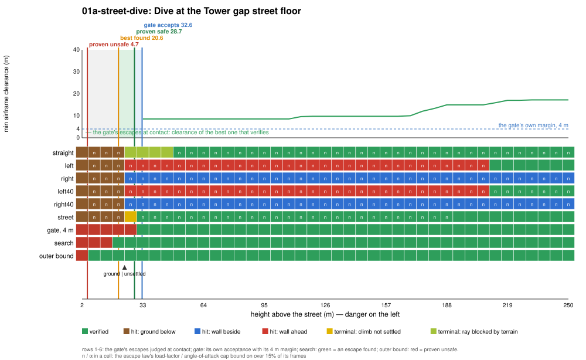
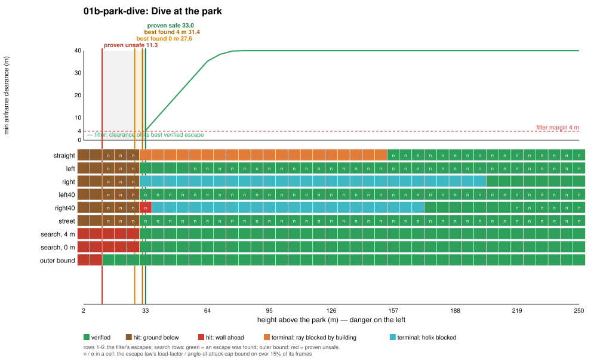

# Regime 1: terrain or roof below

**What it is.** The aircraft is descending toward a floor (the street, the park, a roof) and the only way out is to stop the descent before the floor arrives. What decides it: the height above the floor, the vertical speed (here set by a fixed dive angle) and the airspeed, which sets how hard the aircraft can pull. On both slices every failing escape hits the floor with the escape law's 3.3 to 3.5 g load-factor cap binding (the `n` marks in the plot), so this is a load-factor-limited pull-out, not a stall-limited one.

Regime 6 is this same piece of the boundary seen along the speed axis (same floor, same binding load-factor cap); see [06-high-speed](../06-high-speed/README.md).

## Locations

| Slice | Where | Fixed | Varied |
|---|---|---|---|
| `01a-street-dive` | The Tower gap street, `x = −120` (28 m wide, between the 261 m and 292 m towers of block row 9). Start over `(−120, −150)`, heading north up the street. | 50 m/s, dive −30°, wings level, throttle 0.6 | height above the street, 2 to 250 m |
| `01b-park-dive` | The 2×2-block park, `x ∈ [−466, −254]`, `y ∈ [254, 466]`, with 75 to 160 m towers on its east side. Start over `(−360, 260)`, heading north along the park's middle street. | 50 m/s, dive −35°, wings level, throttle 0.6 | height above the park, 2 to 250 m |

The street dive is the dramatic one: the pull-out happens in a 28 m slot between 260 to 290 m towers. The park dive is the clean one: an open floor with nothing beside the pull-out.

## Slices

| Slice | Proven safe | Best found, 4 m | Best found, 0 m | Proven unsafe | Filter conservatism | Cost of the 4 m margin | Outer-bound slack |
|---|---|---|---|---|---|---|---|
| street dive | 32.6 m | 26.4 m | 22.5 m | 8.6 m | 6.2 m | 3.9 m | 13.9 m |
| park dive | 33.0 m | 31.4 m | 27.6 m | 11.3 m | 1.6 m | 3.9 m | 16.3 m |

**Binding causes along the slices.** Below the markers every escape hits the ground with the load-factor cap binding. In the park, once the floor is cleared, the straight escape still fails for a different reason: its terminal ray is blocked by the towers north of the park (`ray-bldg`), and the 30° turns' helices are blocked by the towers around the park (`helix`) up to about 200 m. In the street, the pull-out clears the floor from 33 m up, but then every escape except the street escape hits the street's walls (`wall-side`, `wall-ahead`) at every height up to 220 m: the street dive is a floor regime that hands over to the canyon regime (3) as soon as the floor is no longer the problem. Only the street escape (climb along the street axis, roll into a helix once one fits) verifies, from 33 m up. The straight escape joins it from 107 m up.

**Where the conservatism is.** In the park the filter is within 1.6 m of the best escape the richer search found with the same 4 m margin: the filter's 40° turn and street escapes pull about as hard as the aircraft can. In the street the gap is 6.2 m; the search's best program is the street escape itself with the aggressive gains (load factor up to 3.8 g, α up to 0.26, stiffer flight-path loop), so the lever is a harder pull-out in the street escape. The margin costs another 3.9 m in both. The outer bound proves unsafety below 8.6 m and 11.3 m: a point mass at 3.8 g with no transients could stop the 25 and 29 m/s descents in 9 and 12 m, against 23 and 28 m for the best program found on the plant.

<!-- DEMOS -->

<!-- WILD -->

## State of progress

- **Exact:** every escape is flown on the bit-exact JSBSim port (`JsbExact`), frame by frame; the committed escape flies those same frames.
- **Numerical:** clearance is checked every 8 frames (1/16 s), not continuously, and the terminal sets are checked on the settled rollout. In the street-dive demo the flight's own 20 ms clearance trace dips to 3.9 m once, under the 4 m margin, between two checked samples.
- **Formally proved:** this is the only regime with related formal work: `Envelope/` (core Lean) proves a no-hit theorem for a performance-envelope terrain filter on the longitudinal (along-track, height) model, under an envelope assumption the plant must obey (`Allowed`, checked at run time by `monitor`). It is not about this 6-DOF filter, its escapes or buildings.
- **Main lever:** the 4 m margin (3.9 m of the gap in both slices) and, in the street, a harder street-escape pull-out (6.2 m). The outer bound would tighten most by charging the vertical pull for gravity (it credits lift in any direction plus gravity's turn rate).
