# Regime 1: terrain or roof below

**What it is.** The aircraft is descending toward a floor (the street, the park, open ground) and the only way out is to stop the descent before the floor arrives. What decides it: the height above the floor, the vertical speed (here set by a fixed flight-path angle) and the airspeed, which sets how hard the aircraft can pull. Every escape that fails hits the floor.

The slow-flight and fast-dive slices that were regimes 5 and 6 in the first pass end in exactly this contact, so they live here now as slices `01c` and `01d` (the first-pass envelope regimes are kept in the [appendix](../appendix-envelope/README.md)). Along them the escape law's α cap (slow) or load-factor cap (fast) is what limits the pull-out; those caps are the filter's design choices, not safety limits.

## Locations

| Slice | Where | Fixed | Varied |
|---|---|---|---|
| `01a-street-dive` | The Tower gap street, `x = −120` (28 m wide, between the 261 m and 292 m towers of block row 9). Start over `(−120, −150)`, heading north up the street. | 50 m/s, dive −30°, wings level, throttle 0.6 | height above the street, 2 to 250 m |
| `01b-park-dive` | The 2×2-block park, `x ∈ [−466, −254]`, `y ∈ [254, 466]`, with 75 to 160 m towers on its east side. Start over `(−360, 260)`, heading north along the park's middle street. | 50 m/s, dive −35°, wings level, throttle 0.6 | height above the park, 2 to 250 m |
| `01c-slow-valley` | The open valley south of the city, over `(0, −1600)`, heading east, 12 m above the ground. | flight path +8°, idle, wings level | airspeed, 20 to 36 m/s |
| `01d-fast-dive` | The park dive's geometry, 45 m above the park. | dive −35°, wings level, throttle 0.6 | airspeed, 35 to 95 m/s |

The street dive is the dramatic one: the pull-out happens in a 28 m slot between 260 to 290 m towers. The park dive is the clean one. The airspeed slices stop at 20 m/s because the plant's initial state (`JsbPlant::new`) does not start the c172 slower than that, and at 95 m/s, well past the c172's Vne (about 84 m/s).

## Slices


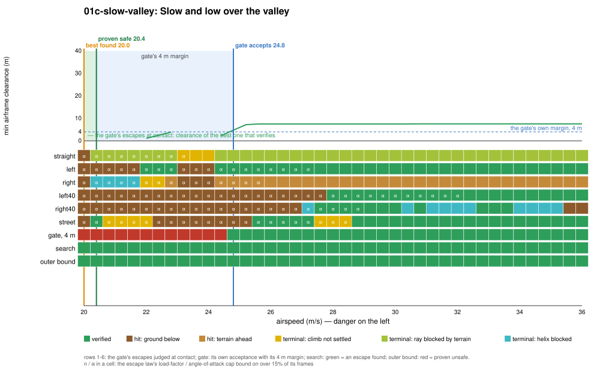

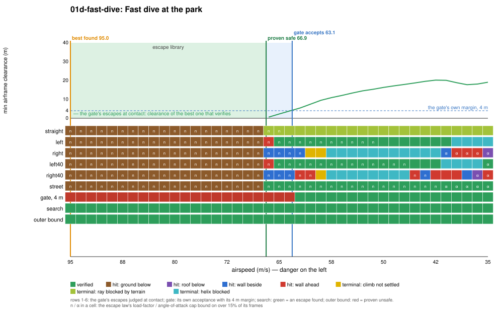

| Slice | Gate accepts (its 4 m margin) | Proven safe (contact) | Best found (contact) | Proven unsafe | Gate's own margin | Escape library and terminal sets | Outer-bound slack |
|---|---|---|---|---|---|---|---|
| street dive (m) | 32.6 | 28.7 | 20.6 | 4.7 | 3.9 | 8.1 | 15.9 |
| park dive (m) | 33.0 | 28.7 | 24.1 | 5.9 | 4.3 | 4.6 | 18.2 |
| slow valley (m/s) | 24.8 | 20.4 | ≤ 20.0 (slice end) | none | 4.4 | ≥ 0.4 | – |
| fast dive (m/s) | 63.1 | 66.9 | ≥ 95.0 (slice end) | none | 3.8 | ≥ 28.1 | – |

**Binding causes along the slices** (the gate's escapes judged at contact). Below the markers every escape hits the ground, with the escape law's load-factor cap binding on the dives and its α cap in the slow valley. Once the floor is cleared other things bind. In the street, only the street escape (climb along the street axis, roll into a helix once one fits) verifies from the marker up; the turns hit the street's walls (`wall-side`, `wall-ahead`) at every height up to 210 m (the right turns beyond), and the straight escape's climbing ray is blocked by the hills north of the city below 51 m. Above the floor, the street dive is a canyon (regime 3). In the park, the straight escape's ray is blocked the same way below 150 m, and the right turns' helices by the towers east of the park below 175 to 200 m. In the slow valley the closest verified point, 20.4 m/s, is an isolated one (the street escape); the left 30° turn, on its α cap, verifies from 22 m/s, and 20.8 to 21.2 and 23.2 to 23.6 m/s are rejected in between. On the fast dive, faster than 67 m/s every escape hits the ground on its load-factor cap; the richer search, with no load-factor ceiling, pulls out at every speed up to 95 m/s (its program at 95 m/s pulls 5.9 g for a third of a second).

**Where the gap is.** The gate's own margin accounts for 3.8 to 4.4 units on every slice: 4 m of clearance is 4 m of height on a pull-out. The escape library accounts for 4.6 m (park) and 8.1 m (street) on the dives: the search's best programs are a harder street escape (n ≤ 6, α ≤ 0.27, a stiffer flight-path loop) and a 6 g pull for 1.6 s, where the gate's escape law stops at 3.5 g. On the fast dive the library's 3.5 g cap is the whole story: the plant itself pulls out of a 95 m/s dive from 45 m at up to 6.8 g. The outer bound proves unsafety below 4.7 m and 5.9 m on the dives: a point mass with the plant's stall-limited lift (no load-factor cap) and full thrust stops a 25 to 29 m/s descent in that height. It proves nothing on the airspeed slices.

<!-- DEMOS -->
## Demos (run from `flight/`)

### Demo: Dive at the Tower gap street floor (01a-street-dive)

**Closest safe call** (the proven-safe state; the gate with its margin set to zero and clearance checked every frame, `--margin 0 --check-every 1`; pilot lead-in 3.00 s with the sticks released, so the fly-by-wire holds flight path and bank into the obstacle):

```sh
cargo run --release --features jsb -- --env gate --time-cap 0 --margin 0 --check-every 1 --start -120.00,-150.00,37.11,50.00,-30.000,90.000,0.000,0.60 --lead 3 --cinematic --paths --label "01a-street-dive: closest safe call, zero-margin gate, 28.7 m"
```

- filter on: no crash; closest pass during the save **0.01 m** at t = 4.2 s; minimum over 25 s 0.01 m (filter takes over at t = 2.7 s, hands back at 2.7 s, 17 takeovers in all)
- filter off (`--off`): **crashes** at t = 3.5 s (filter never takes over; start not verified)

**Just-barely-unsafe twin**: 8.0 m closer than the proven-safe marker, no lead-in, same zero-margin gate. No escape verifies at the start, so the gate commits blind to the escape that got farthest:

```sh
cargo run --release --features jsb -- --env gate --time-cap 0 --margin 0 --check-every 1 --start -120.00,-150.00,29.11,50.00,-30.000,90.000,0.000,0.60 --cinematic --paths --label "01a-street-dive: unverified twin, 20.7 m"
```

- filter on: **crashes** at t = 0.8 s (filter takes over at t = 0.0 s; start not verified)

**The deployed gate (4 m margin)** from its own acceptance marker (lead-in 3.00 s):

```sh
cargo run --release --features jsb -- --env gate --time-cap 0 --start -120.00,-150.00,40.98,50.00,-30.000,90.000,0.000,0.60 --lead 3 --cinematic --paths --label "01a-street-dive: closest call, deployed gate, 32.6 m"
```

- filter on: no crash; closest pass during the save **4.00 m** at t = 4.2 s; minimum over 25 s 3.88 m (filter takes over at t = 2.7 s, hands back at 2.7 s, 13 takeovers in all)
- filter off: **crashes** at t = 3.6 s (filter never takes over; start not verified)

**Closest proven-unsafe call**:

```sh
cargo run --release --features jsb -- --env gate --time-cap 0 --start -120.00,-150.00,13.08,50.00,-30.000,90.000,0.000,0.60 --cinematic --paths --label "01a-street-dive: proven unsafe, 4.7 m"
cargo run --release --features jsb -- --env gate --time-cap 0 --start -120.00,-150.00,13.08,50.00,-30.000,90.000,0.000,0.60 --cinematic --paths --off --label "01a-street-dive: proven unsafe, 4.7 m"
```

- filter on: **crashes** at t = 0.0 s (filter takes over at t = 0.0 s; start not verified)
- filter off: **crashes** at t = 0.0 s (filter never takes over; start not verified)
- the gate's escapes flown with no margin: 6 of 6 touch (straight hits at 0.0 s, left hits at 0.0 s, right hits at 0.0 s, left40 hits at 0.0 s, right40 hits at 0.0 s, street hits at 0.0 s)


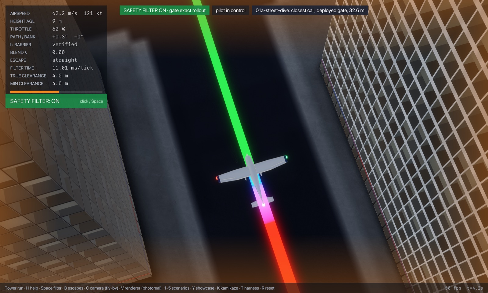 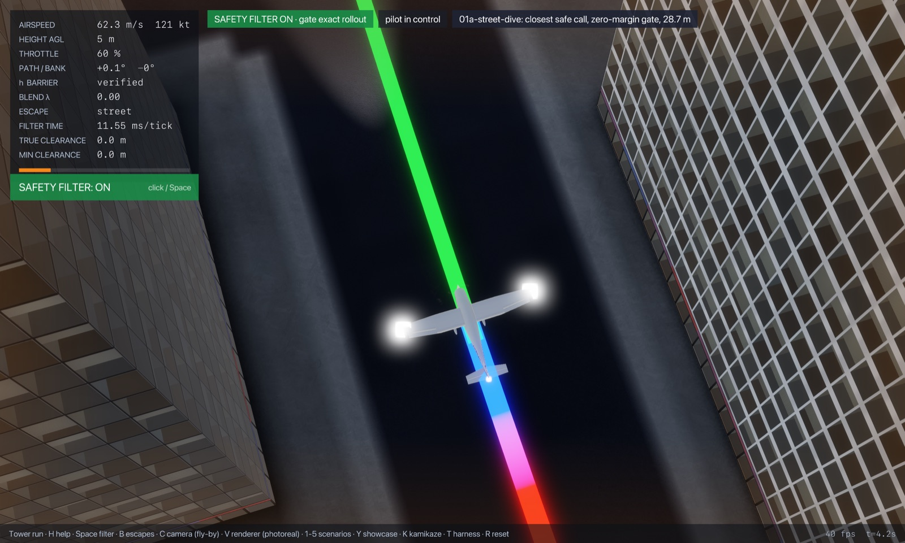 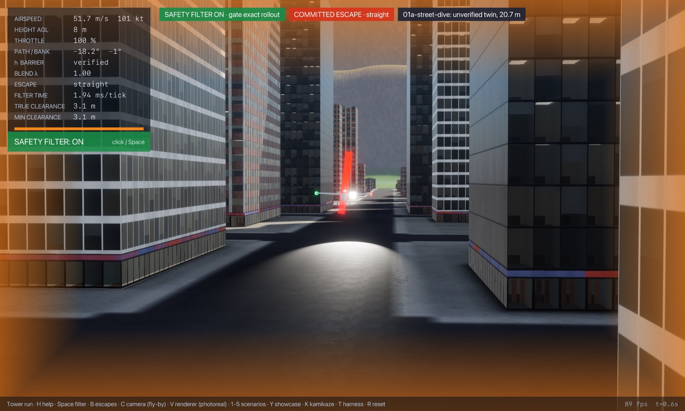 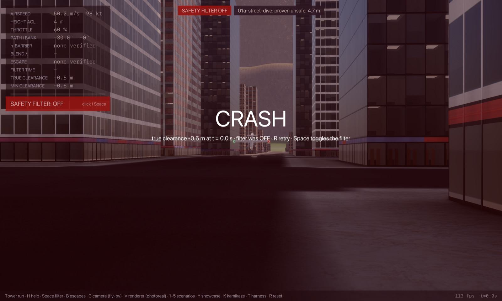

### Demo: Dive at the park (01b-park-dive)

**Closest safe call** (the proven-safe state; the gate with its margin set to zero and clearance checked every frame, `--margin 0 --check-every 1`; pilot lead-in 3.00 s with the sticks released, so the fly-by-wire holds flight path and bank into the obstacle):

```sh
cargo run --release --features jsb -- --env gate --time-cap 0 --margin 0 --check-every 1 --start -360.00,260.00,36.14,50.00,-35.000,90.000,0.000,0.60 --lead 3 --cinematic --paths --label "01b-park-dive: closest safe call, zero-margin gate, 28.7 m"
```

- filter on: no crash; closest pass during the save **0.01 m** at t = 4.2 s; minimum over 25 s 0.00 m (filter takes over at t = 2.4 s, hands back at 2.4 s, 11 takeovers in all)
- filter off (`--off`): **crashes** at t = 3.4 s (filter never takes over; start not verified)

**Just-barely-unsafe twin**: 0.5 m closer than the proven-safe marker, no lead-in, same zero-margin gate. No escape verifies at the start, so the gate commits blind to the escape that got farthest:

```sh
cargo run --release --features jsb -- --env gate --time-cap 0 --margin 0 --check-every 1 --start -360.00,260.00,35.64,50.00,-35.000,90.000,0.000,0.60 --cinematic --paths --label "01b-park-dive: unverified twin, 28.2 m"
```

- filter on: **crashes** at t = 1.3 s (filter takes over at t = 0.0 s; start not verified)

**The deployed gate (4 m margin)** from its own acceptance marker (lead-in 3.00 s):

```sh
cargo run --release --features jsb -- --env gate --time-cap 0 --start -360.00,260.00,40.40,50.00,-35.000,90.000,0.000,0.60 --lead 3 --cinematic --paths --label "01b-park-dive: closest call, deployed gate, 33.0 m"
```

- filter on: no crash; closest pass during the save **3.84 m** at t = 8.5 s; minimum over 25 s 3.84 m (filter takes over at t = 2.4 s, hands back at 2.4 s, 13 takeovers in all)
- filter off: **crashes** at t = 3.5 s (filter never takes over; start not verified)

**Closest proven-unsafe call**:

```sh
cargo run --release --features jsb -- --env gate --time-cap 0 --start -360.00,260.00,13.28,50.00,-35.000,90.000,0.000,0.60 --cinematic --paths --label "01b-park-dive: proven unsafe, 5.9 m"
cargo run --release --features jsb -- --env gate --time-cap 0 --start -360.00,260.00,13.28,50.00,-35.000,90.000,0.000,0.60 --cinematic --paths --off --label "01b-park-dive: proven unsafe, 5.9 m"
```

- filter on: **crashes** at t = 0.0 s (filter takes over at t = 0.0 s; start not verified)
- filter off: **crashes** at t = 0.0 s (filter never takes over; start not verified)
- the gate's escapes flown with no margin: 6 of 6 touch (straight hits at 0.0 s, left hits at 0.0 s, right hits at 0.0 s, left40 hits at 0.0 s, right40 hits at 0.0 s, street hits at 0.0 s)


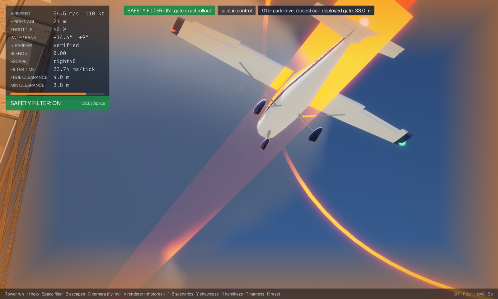 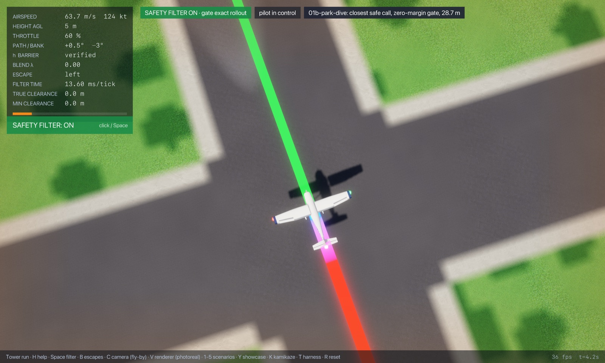 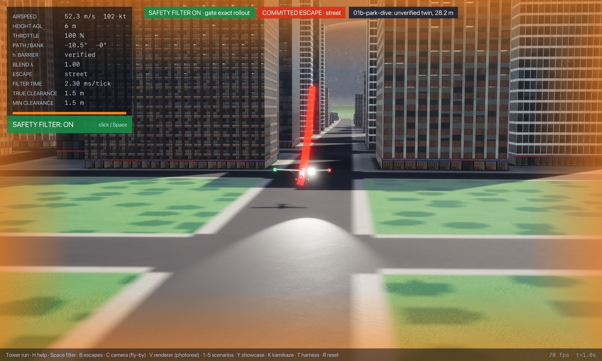 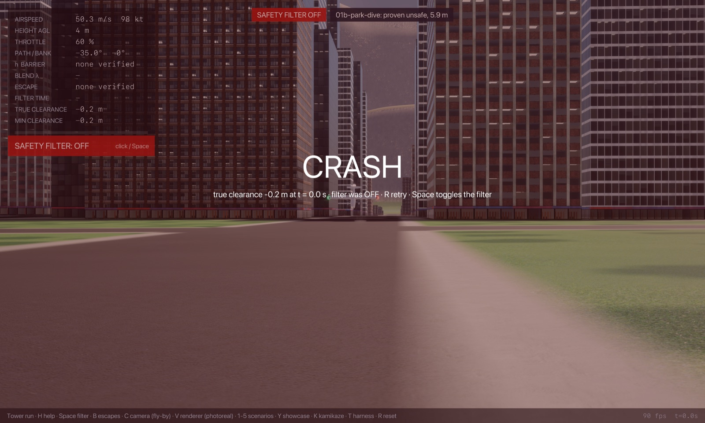

### Demo: Slow and low over the valley (01c-slow-valley)

**Closest safe call** (the proven-safe state; the gate with its margin set to zero and clearance checked every frame, `--margin 0 --check-every 1`; pilot lead-in 0.00 s with the sticks released, so the fly-by-wire holds flight path and bank into the obstacle):

```sh
cargo run --release --features jsb -- --env gate --time-cap 0 --margin 0 --check-every 1 --start 0.00,-1600.00,21.85,20.40,8.000,0.000,0.000,0.00 --lead 0 --cinematic --cam 0 --paths --label "01c-slow-valley: closest safe call, zero-margin gate, 20.4 m/s"
```

- filter on: no crash; closest pass during the save **0.00 m** at t = 5.7 s; minimum over 25 s 0.00 m (filter takes over at t = 0.1 s, hands back at 0.1 s, 143 takeovers in all)
- filter off (`--off`): **crashes** at t = 3.6 s (filter never takes over; start not verified)

**Twin**: no start between the proven-safe marker and the outer bound (or the slice's end) crashed under the zero-margin gate: its blind fallback escape survived every one tried.

**The deployed gate (4 m margin)** from its own acceptance marker (lead-in 0.00 s):

```sh
cargo run --release --features jsb -- --env gate --time-cap 0 --start 0.00,-1600.00,21.85,24.80,8.000,0.000,0.000,0.00 --lead 0 --cinematic --cam 0 --paths --label "01c-slow-valley: closest call, deployed gate, 24.8 m/s"
```

- filter on: no crash; closest pass during the save **7.74 m** at t = 0.1 s; minimum over 25 s 4.00 m (filter takes over at t = 0.1 s, hands back at 0.1 s, 175 takeovers in all)
- filter off: **crashes** at t = 5.8 s (filter never takes over; start not verified)


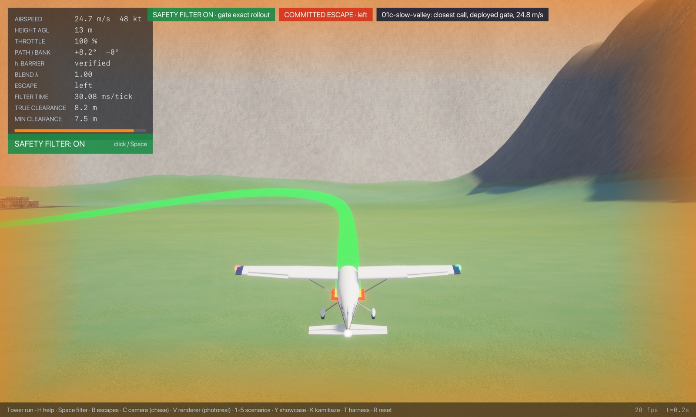 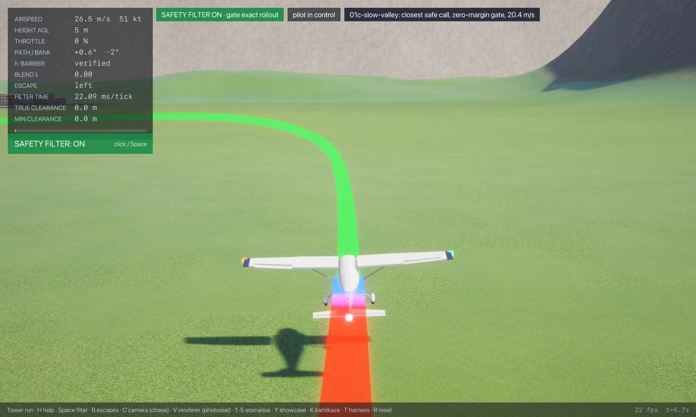

### Demo: Fast dive at the park (01d-fast-dive)

**Closest safe call** (the proven-safe state; the gate with its margin set to zero and clearance checked every frame, `--margin 0 --check-every 1`; pilot lead-in 3.00 s with the sticks released, so the fly-by-wire holds flight path and bank into the obstacle):

```sh
cargo run --release --features jsb -- --env gate --time-cap 0 --margin 0 --check-every 1 --start -360.00,260.00,52.40,66.88,-35.000,90.000,0.000,0.60 --lead 3 --cinematic --paths --label "01d-fast-dive: closest safe call, zero-margin gate, 66.9 m/s"
```

- filter on: no crash; closest pass during the save **0.01 m** at t = 5.0 s; minimum over 25 s 0.01 m (filter takes over at t = 1.5 s, hands back at 1.6 s, 13 takeovers in all)
- filter off (`--off`): **crashes** at t = 3.8 s (filter never takes over; start not verified)

**Just-barely-unsafe twin**: 0.5 m/s closer than the proven-safe marker, no lead-in, same zero-margin gate. No escape verifies at the start, so the gate commits blind to the escape that got farthest:

```sh
cargo run --release --features jsb -- --env gate --time-cap 0 --margin 0 --check-every 1 --start -360.00,260.00,52.40,67.38,-35.000,90.000,0.000,0.60 --cinematic --paths --label "01d-fast-dive: unverified twin, 67.4 m/s"
```

- filter on: **crashes** at t = 1.7 s (filter takes over at t = 0.0 s; start not verified)

**The deployed gate (4 m margin)** from its own acceptance marker (lead-in 3.00 s):

```sh
cargo run --release --features jsb -- --env gate --time-cap 0 --start -360.00,260.00,52.40,63.12,-35.000,90.000,0.000,0.60 --lead 3 --cinematic --paths --label "01d-fast-dive: closest call, deployed gate, 63.1 m/s"
```

- filter on: no crash; closest pass during the save **4.00 m** at t = 5.0 s; minimum over 25 s 4.00 m (filter takes over at t = 1.4 s, hands back at 1.4 s, 16 takeovers in all)
- filter off: **crashes** at t = 3.8 s (filter never takes over; start not verified)


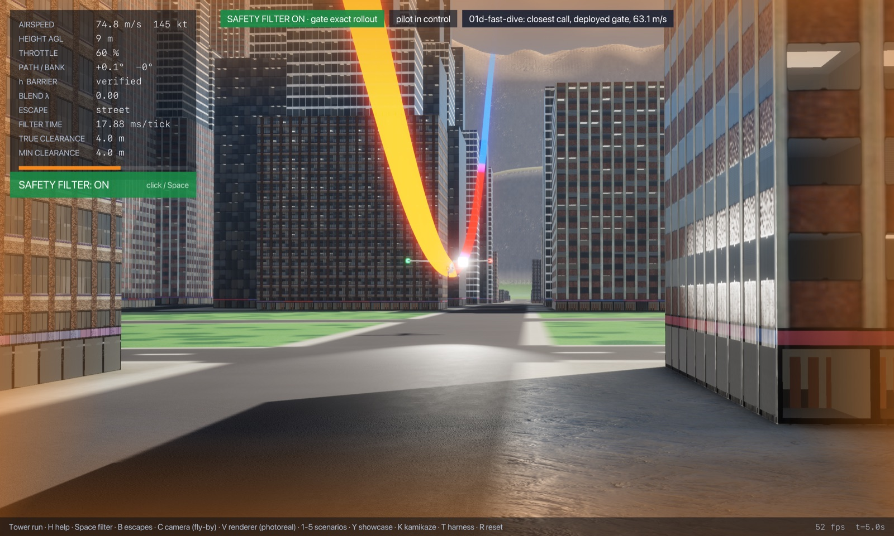 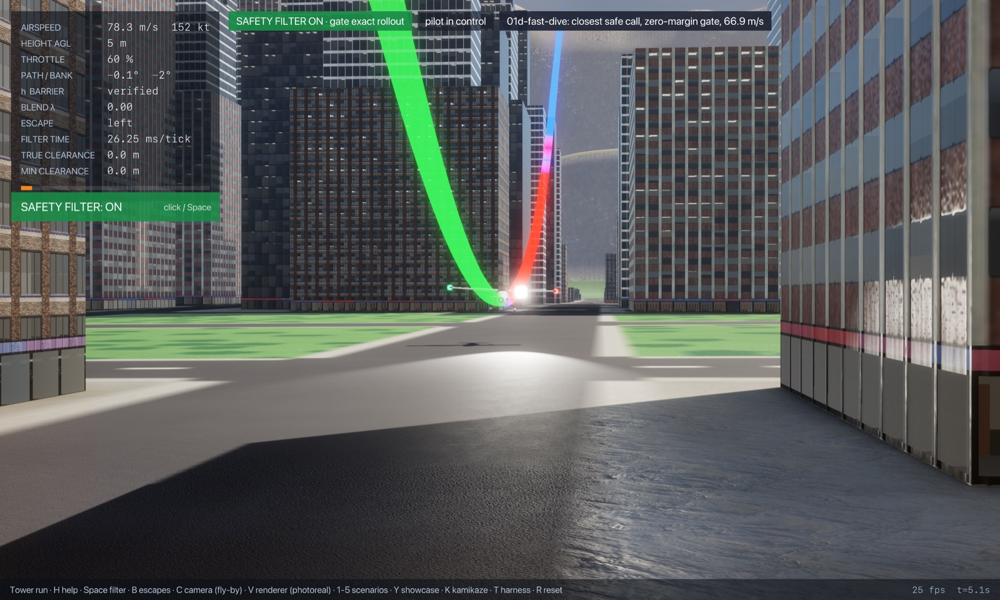 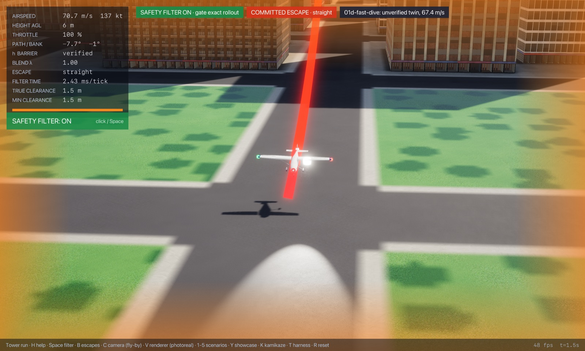
<!-- /DEMOS -->

<!-- WILD -->
## In the wild

Of the 22100 commit runs (filter takeovers) in the 200 hostile-pilot harness episodes, 16400 in 200 episodes fall in this regime (classified by the cause of the escape that got farthest, judged as the deployed gate judges it, with its 4 m margin, from the state where it rejected the pilot; `regimes wild`, `wild.csv`): hit the ground 12400, roof below 4000.

The three closest saves (lowest airframe clearance during the takeover):

| Episode | Takeover at | Cause | Airspeed | Closest pass | Replay (from `flight/`) |
|---|---|---|---|---|---|
| 91 | t = 50.6 s | roof below | 73 m/s | 3.7 m | `cargo run --release --features jsb -- --env gate --time-cap 0 --episode 91 --paths --cinematic --cam 0` |
| 119 | t = 43.9 s | roof below | 79 m/s | 3.7 m | `cargo run --release --features jsb -- --env gate --time-cap 0 --episode 119 --paths --cinematic --cam 0` |
| 3 | t = 57.8 s | roof below | 79 m/s | 3.7 m | `cargo run --release --features jsb -- --env gate --time-cap 0 --episode 3 --paths --cinematic --cam 0` |
<!-- /WILD -->

## State of progress

- **Exact:** every escape is flown on the bit-exact JSBSim port (`JsbExact`), frame by frame, and the contact markers check airframe clearance at every frame (1/128 s), as JSBSim itself steps.
- **Numerical:** the terminal sets (climbing ray, helix) are checked on the settled rollout; they are a proof device, not part of the objective. The airframe is the gate's model (a 4.5 m body sphere plus a 0.8 m-radius capsule along the wing), which encloses the c172 with room to spare below the fuselage; the objective's own contact shape is still open (`docs/safety-objective.md`).
- **Formally proved:** this is the only regime with related formal work: `Envelope/` (core Lean) proves a no-hit theorem for a performance-envelope terrain filter on the longitudinal (along-track, height) model, under an envelope assumption the plant must obey (`Allowed`, checked at run time by `monitor`). It is not about this 6-DOF filter, its escapes or buildings.
- **Main lever:** the gate's margin (about 4 m everywhere) and the escape law's load-factor cap (5 to 8 m on the dives, more than 28 m/s on the fast dive). The outer bound would tighten most by charging the vertical pull for gravity (it credits lift in any direction plus gravity's turn rate).
