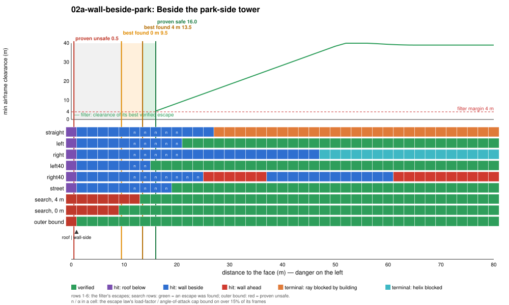
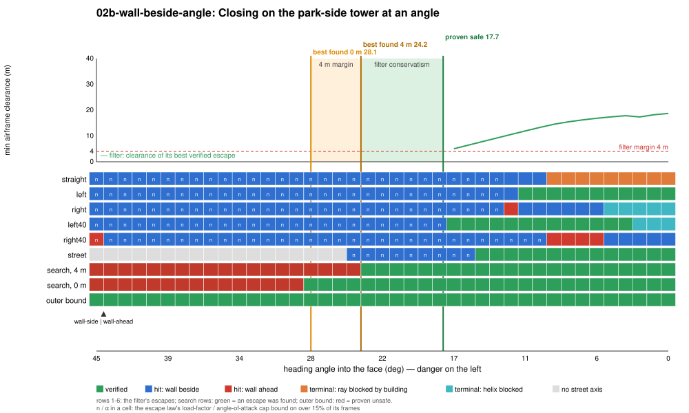
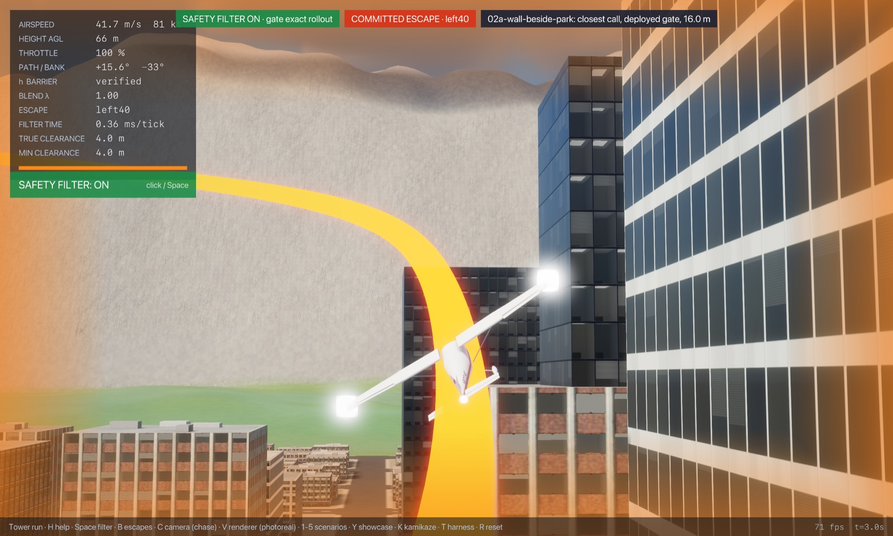
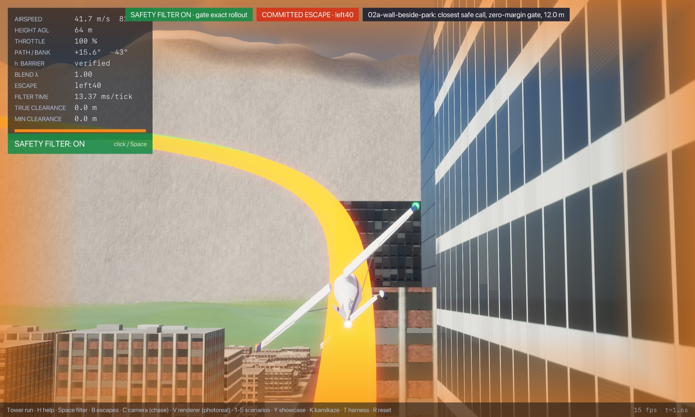
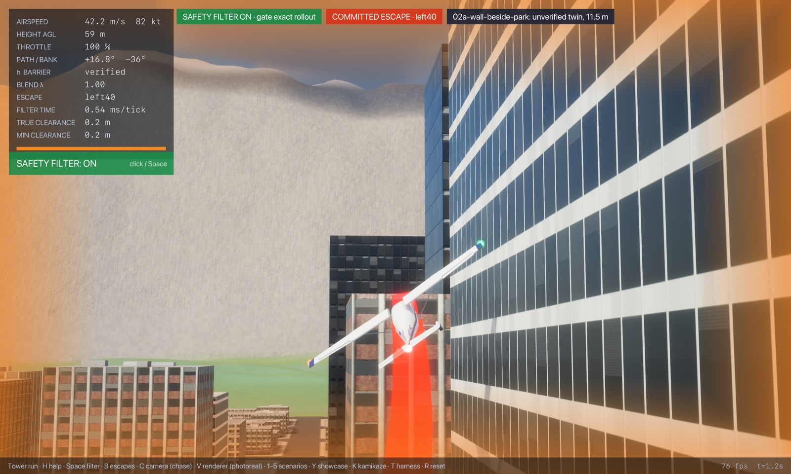
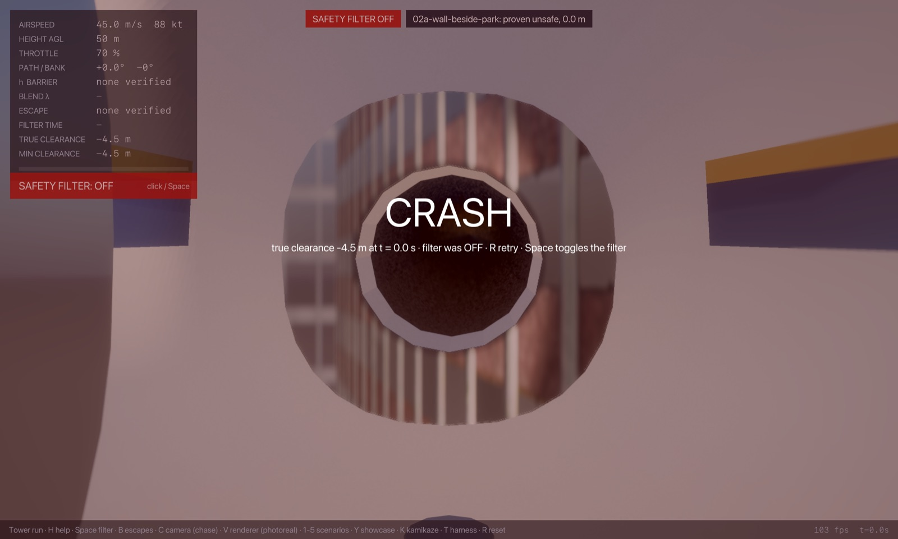
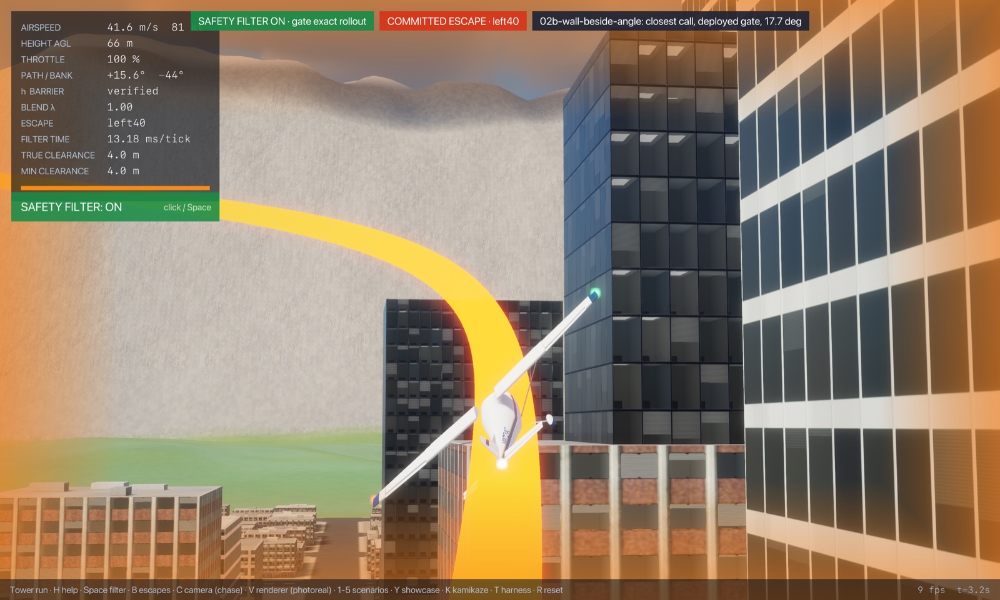
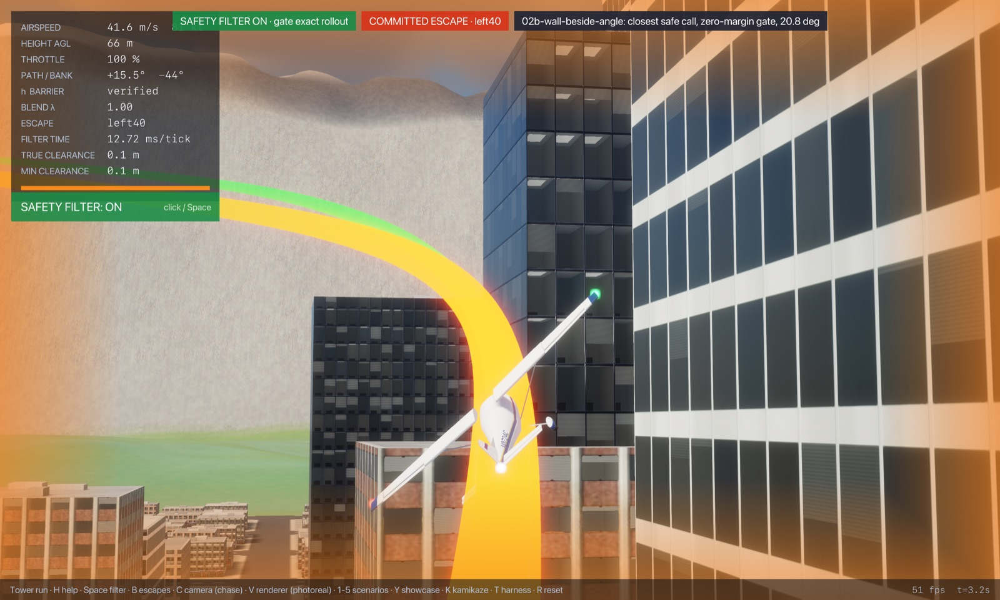
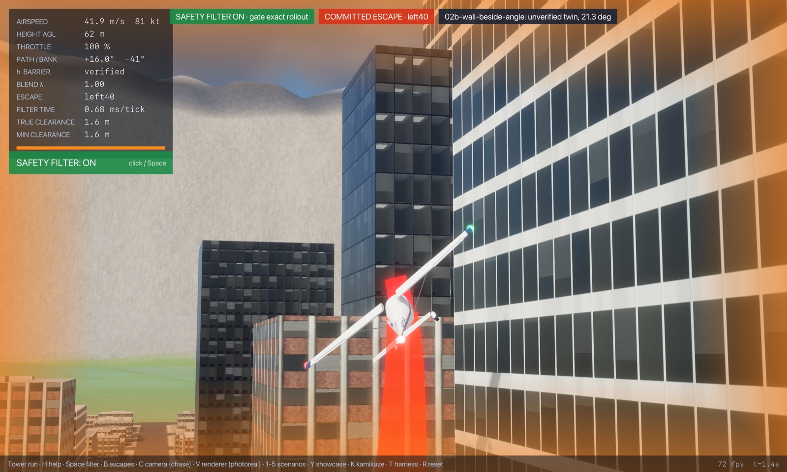

# Regime 2: wall beside

**What it is.** A tall face runs alongside the aircraft, which is drifting toward it at a shallow angle. The way out is to turn away before the drift closes the gap, and the wing on the wall side is what touches first. What decides it: the distance to the face, the heading angle into it, and the bank (which tilts the near wingtip toward or away from the glass). Every escape that fails hits the face beside it (`wall-side`).

## Location

The west face of the park-side tower: box `x ∈ [−218.1, −186.2]`, `y ∈ [255.8, 334.5]`, 87 m tall, with 129 m and 157 m setback tiers behind it. The park is open to the west. Start abreast of the face's south end, `y = 265`, 50 m above the ground, 45 m/s, wings level, heading north and turned into the face.

| Slice | Fixed | Varied |
|---|---|---|
| `02a-wall-beside-park` | heading 10° into the face | distance from the aircraft's centre to the face, 0 to 80 m |
| `02b-wall-beside-angle` | 25 m from the face | heading angle into the face, 0 to 45° |

## Slices





| Slice | Gate accepts (its 4 m margin) | Proven safe (contact) | Best found (contact) | Proven unsafe | Gate's own margin | Escape library and terminal sets | Outer-bound slack |
|---|---|---|---|---|---|---|---|
| distance (m) | 16.0 | 12.0 | 9.5 | 0.0 (touching) | 4.0 | 2.5 | 9.5 |
| angle at 25 m (°) | 17.7 | 20.8 | 28.4 | none to 45° | 3.1 | 7.6 | ≥ 16.6 |

**Binding causes along the slices.** On the distance slice the left 40° turn (away from the face) verifies closest, from 12 m; the street escape joins at 16 m and the left 30° turn at 18 m. The right turns (toward the face) hit it, or the tower beyond, far out along the slice, and the straight escape hits it out to 22 m; beyond that its climbing ray is blocked by the hills north of the city. On the angle slice the same left 40° turn verifies up to 20.8° and everything hits the face beside it beyond that; beyond about 26° the street escape finds no street axis within 25° of its track.

**Where the gap is.** The gate's margin is 4 m on the distance slice, and worth 3.1° of closing angle. The escape library costs 2.5 m and 7.6°: the search's programs roll into a 49° to 55° bank and pull 3.8 to 4.7 g for under a second before a 46° climbing turn or the street escape, where the library's steepest turn is 40° at 3.5 g. The outer bound proves nothing useful here: a point mass may put all its lift sideways at once, which stops a 10° drift at 45 m/s (7.8 m/s toward the face) within a metre, so it only fires with the aircraft already at the face, and never on the angle slice.

<!-- DEMOS -->
## Demos (run from `flight/`)

### Demo: Beside the park-side tower (02a-wall-beside-park)

**Closest safe call** (the proven-safe state; the gate with its margin set to zero and clearance checked every frame, `--margin 0 --check-every 1`; pilot lead-in 0.00 s with the sticks released, so the fly-by-wire holds flight path and bank into the obstacle):

```sh
cargo run --release --features jsb -- --safety-filter exact-rollout --time-cap 0 --margin 0 --check-every 1 --start -230.10,265.00,56.98,45.00,0.000,80.000,0.000,0.70 --lead 0 --cinematic --cam 0 --paths --label "02a-wall-beside-park: closest safe call, zero-margin gate, 12.0 m"
```

- filter on: no crash; closest pass during the save **0.03 m** at t = 1.6 s; minimum over 25 s 0.02 m (filter takes over at t = 0.1 s, hands back at 1.9 s, 3 takeovers in all)
- filter off (`--off`): **crashes** at t = 0.7 s (filter never takes over; start not verified)

**Just-barely-unsafe twin**: 0.5 m closer than the proven-safe marker, no lead-in, same zero-margin gate. No escape verifies at the start, so the gate commits blind to the escape that got farthest:

```sh
cargo run --release --features jsb -- --safety-filter exact-rollout --time-cap 0 --margin 0 --check-every 1 --start -229.60,265.00,56.98,45.00,0.000,80.000,0.000,0.70 --cinematic --cam 0 --paths --label "02a-wall-beside-park: unverified twin, 11.5 m"
```

- filter on: **crashes** at t = 1.4 s (filter takes over at t = 0.0 s; start not verified)

**The deployed gate (4 m margin)** from its own acceptance marker (lead-in 1.50 s):

```sh
cargo run --release --features jsb -- --safety-filter exact-rollout --time-cap 0 --start -234.10,265.00,57.00,45.00,0.000,80.000,0.000,0.70 --lead 1.5 --cinematic --cam 0 --paths --label "02a-wall-beside-park: closest call, deployed gate, 16.0 m"
```

- filter on: no crash; closest pass during the save **4.01 m** at t = 3.0 s; minimum over 25 s 4.01 m (filter takes over at t = 1.0 s, hands back at 1.4 s, 4 takeovers in all)
- filter off: **crashes** at t = 2.7 s (filter never takes over; start not verified)

**Closest proven-unsafe call**:

```sh
cargo run --release --features jsb -- --safety-filter exact-rollout --time-cap 0 --start -218.10,265.00,56.92,45.00,0.000,80.000,0.000,0.70 --cinematic --cam 0 --paths --label "02a-wall-beside-park: proven unsafe, 0.0 m"
cargo run --release --features jsb -- --safety-filter exact-rollout --time-cap 0 --start -218.10,265.00,56.92,45.00,0.000,80.000,0.000,0.70 --cinematic --cam 0 --paths --off --label "02a-wall-beside-park: proven unsafe, 0.0 m"
```

- filter on: **crashes** at t = 0.0 s (filter takes over at t = 0.0 s; start not verified)
- filter off: **crashes** at t = 0.0 s (filter never takes over; start not verified)
- the gate's escapes flown with no margin: 6 of 6 touch (straight hits at 0.0 s, left hits at 0.0 s, right hits at 0.0 s, left40 hits at 0.0 s, right40 hits at 0.0 s, street hits at 0.0 s)


   

### Demo: Closing on the park-side tower at an angle (02b-wall-beside-angle)

**Closest safe call** (the proven-safe state; the gate with its margin set to zero and clearance checked every frame, `--margin 0 --check-every 1`; pilot lead-in 1.50 s with the sticks released, so the fly-by-wire holds flight path and bank into the obstacle):

```sh
cargo run --release --features jsb -- --safety-filter exact-rollout --time-cap 0 --margin 0 --check-every 1 --start -243.10,265.00,57.05,45.00,0.000,69.190,0.000,0.70 --lead 1.5 --cinematic --cam 0 --paths --label "02b-wall-beside-angle: closest safe call, zero-margin gate, 20.8 deg"
```

- filter on: no crash; closest pass during the save **0.08 m** at t = 3.2 s; minimum over 25 s 0.08 m (filter takes over at t = 1.5 s, hands back at 4.8 s, 8 takeovers in all)
- filter off (`--off`): **crashes** at t = 2.7 s (filter never takes over; start not verified)

**Just-barely-unsafe twin**: 0.5 deg closer than the proven-safe marker, no lead-in, same zero-margin gate. No escape verifies at the start, so the gate commits blind to the escape that got farthest:

```sh
cargo run --release --features jsb -- --safety-filter exact-rollout --time-cap 0 --margin 0 --check-every 1 --start -243.10,265.00,57.05,45.00,0.000,68.690,0.000,0.70 --cinematic --cam 0 --paths --label "02b-wall-beside-angle: unverified twin, 21.3 deg"
```

- filter on: **crashes** at t = 1.7 s (filter takes over at t = 0.0 s; start not verified)

**The deployed gate (4 m margin)** from its own acceptance marker (lead-in 1.50 s):

```sh
cargo run --release --features jsb -- --safety-filter exact-rollout --time-cap 0 --start -243.10,265.00,57.05,45.00,0.000,72.280,0.000,0.70 --lead 1.5 --cinematic --cam 0 --paths --label "02b-wall-beside-angle: closest call, deployed gate, 17.7 deg"
```

- filter on: no crash; closest pass during the save **3.97 m** at t = 3.2 s; minimum over 25 s 3.97 m (filter takes over at t = 1.5 s, hands back at 3.4 s, 6 takeovers in all)
- filter off: **crashes** at t = 2.8 s (filter never takes over; start not verified)


  
<!-- /DEMOS -->

<!-- WILD -->
## In the wild

Of the 2996 commit runs (filter takeovers) in the 200 hostile-pilot harness episodes, 151 in 81 episodes fall in this regime (classified by the cause of the escape that got farthest, judged as the deployed gate judges it, with its 4 m margin, from the state where it rejected the pilot; `regimes wild`, `wild.csv`): wall beside 151.

The three closest saves (lowest airframe clearance during the takeover):

| Episode | Takeover at | Cause | Airspeed | Closest pass | Replay (from `flight/`) |
|---|---|---|---|---|---|
| 67 | t = 34.4 s | wall beside | 54 m/s | 3.8 m | `cargo run --release --features jsb -- --safety-filter exact-rollout --time-cap 0 --episode 67 --check-threads 0 --paths --cinematic --cam 0` |
| 143 | t = 55.5 s | wall beside | 60 m/s | 3.9 m | `cargo run --release --features jsb -- --safety-filter exact-rollout --time-cap 0 --episode 143 --check-threads 0 --paths --cinematic --cam 0` |
| 23 | t = 11.3 s | wall beside | 72 m/s | 3.9 m | `cargo run --release --features jsb -- --safety-filter exact-rollout --time-cap 0 --episode 23 --check-threads 0 --paths --cinematic --cam 0` |
<!-- /WILD -->

## State of progress

- **Exact:** escapes flown on the bit-exact JSBSim port, contact checked at every frame against the gate's airframe (body sphere plus a capsule along the drawn wing line, banked with the aircraft, `World::airframe_clearance`).
- **Numerical:** terminal sets on the settled rollout (a proof device, not part of the objective).
- **Formally proved:** The Lean port of this gate (`CityGate`, flown with `--safety-filter exact-rollout-lean`) is proved safe in the objective's sense (`CityGate.city_safe`), assuming its end-of-escape test means safe forever (`TermSound`), with its own contact test (a 6 m cube in exact arithmetic, every frame); see `notes/lean-city-gate.md`. This study maps the Rust gate (`--safety-filter exact-rollout`), whose floating-point sphere-and-capsule clearance is not certified, so the Lean gate's own boundaries (its larger keep-out may make it intervene earlier) are not mapped here.
- **Main lever:** the gate's margin (4 m) and a steeper, harder roll-away escape (a 50° to 60° bank for the first second). The outer bound would need lift to support the aircraft's weight in a turn to say anything here.
