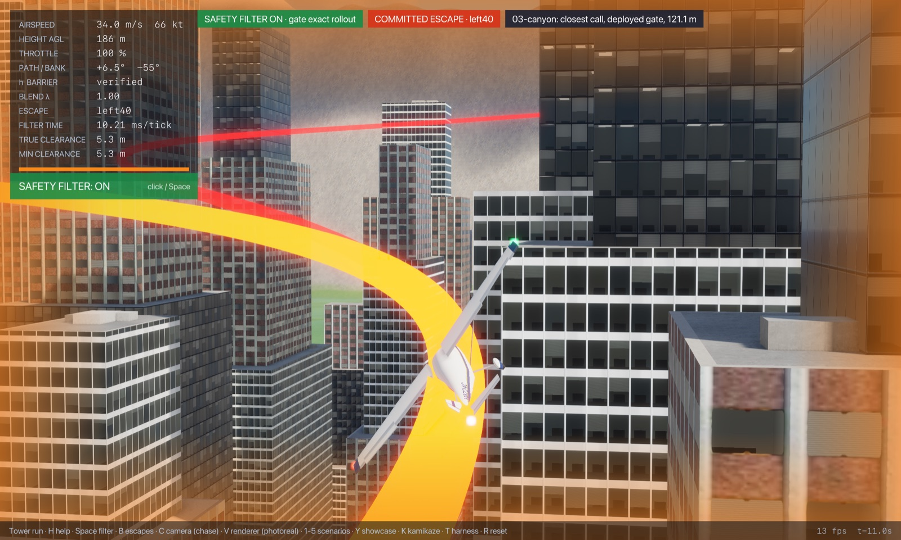
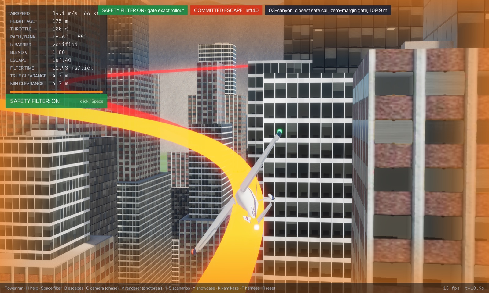
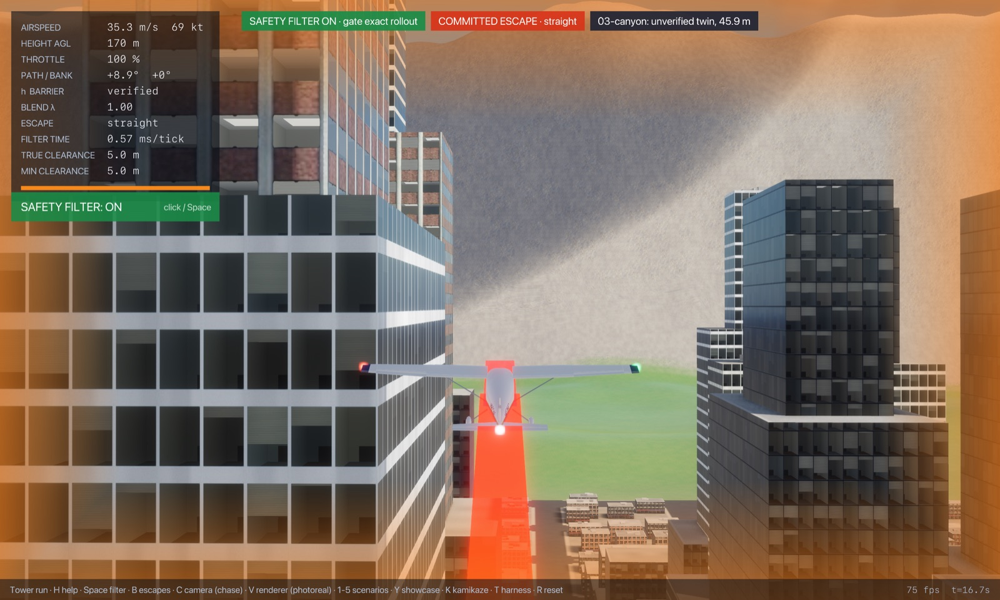

# Regime 3: canyon

**What it is.** The aircraft is flying down a street below the roofs. The street is too narrow to turn in (28 m wide; a 40° turn at 45 m/s needs a radius of about 240 m), so every way out goes along the street and up. Nothing ahead is close: the street is open for 1.6 km. What decides it: the height below the roof line, the length of canyon ahead before a turn or climb-out fits, and the speed. Here what binds the gate is not an obstacle but its **terminal sets**: the escapes that keep to the street do not hit anything, but they never reach a terminal set the gate can certify while still below the roofs, and the ones that turn hit the walls.

## Location

The street `y = 120` (28 m wide), flown east from `x = −470` toward downtown, 45 m/s, level, wings level. Its walls are intermittent: 81 to 196 m tall towers on both sides (`regimes near -600 200 92 148` lists them), broken every 120 m by cross streets and by the gaps between lots (`regimes canyons` found no 240 m stretch in the city where both walls stay above 60 m more than 65% of the way). Varied: height above the street, 15 to 170 m.

## Slice


| Gate accepts (its 4 m margin) | Proven safe (contact) | Best found (contact) | Proven unsafe | Gate's own margin | Escape library and terminal sets | Outer-bound slack |
|---|---|---|---|---|---|---|
| 121.1 m | 109.9 m | 26.6 m | none | 11.1 m | 83.3 m | – |

The richer search finds escapes from 26.6 m up, but not at every height in between (none at 30.5, 42.1, 65.4 or 69.2 m on the grid, for example): the street's geometry makes the best escape depend on where along the block the climb-out happens, and the search is not exhaustive.

**Binding causes along the slice** (at contact). The straight escape fails its terminal test over the whole slice: its climbing ray's corridor widens with distance, runs into the walls (`ray-bldg`) and, above 100 m, into the hills beyond the city (`ray-terrain`). The street escape follows the street climbing, but its terminal test fails the same way until it is near roof height (`ray-terrain`, then `unsettled` and `helix` from 116 m) and it never verifies below 139 m. The turns hit the walls beside them (`wall-side`) or the walls of the cross street they turn into (`wall-ahead`, and `roof` near 65 m). The first escape to verify, at 109.9 m, is the right 30° turn; the 40° turns follow at 127 to 135 m.

**Where the gap is.** The gate's margin is worth 11 m here, more than on any other slice, because the first escape to verify skims a wall: with no margin the right 30° turn gets through 11 m lower. The rest, 83 m, is the terminal-set requirement, not the manoeuvre: the search's programs (a few seconds of hard banked pulls at up to 5.4 g to line up and climb, then the street escape, over a 24 s horizon against 16 s) get out of the canyon by flying along it for longer and climbing, which the street escape also does, but the gate certifies only once a full helix fits. A terminal set for "climbing along a straight open street" (a corridor terminal set) would be the lever. The safety objective has no terminal sets: they are this gate's proof device, so this gap belongs to the gate, not to physics. The outer bound proves nothing: the street is open, so a point mass can always keep flying along it. The demos below make the same point from the other side: with the sticks released the aircraft flies down the street for 25 s without touching anything (filter off), yet the gate takes over 4 to 6 times, each time because no terminal set fits, not because anything was about to be hit.

<!-- DEMOS -->
## Demos (run from `flight/`)

### Demo: Canyon run east along y = 120 (03-canyon)

**Closest safe call** (the proven-safe state; the gate with its margin set to zero and clearance checked every frame, `--margin 0 --check-every 1`; pilot lead-in 3.00 s with the sticks released, so the fly-by-wire holds flight path and bank into the obstacle):

```sh
cargo run --release --features jsb -- --safety-filter exact-rollout --time-cap 0 --margin 0 --check-every 1 --start -470.00,120.00,117.20,45.00,0.000,0.000,0.000,0.70 --lead 3 --cinematic --cam 0 --paths --label "03-canyon: closest safe call, zero-margin gate, 109.9 m"
```

- filter on: no crash; closest pass during the save **4.82 m** at t = 10.9 s; minimum over 25 s 0.43 m (filter takes over at t = 2.9 s, hands back at 6.0 s, 4 takeovers in all)
- filter off (`--off`): no crash; minimum airframe clearance 5.3 m (filter never takes over)

**Just-barely-unsafe twin**: 64.0 m closer than the proven-safe marker, no lead-in, same zero-margin gate. No escape verifies at the start, so the gate commits blind to the escape that got farthest:

```sh
cargo run --release --features jsb -- --safety-filter exact-rollout --time-cap 0 --margin 0 --check-every 1 --start -470.00,120.00,53.20,45.00,0.000,0.000,0.000,0.70 --cinematic --cam 0 --paths --label "03-canyon: unverified twin, 45.9 m"
```

- filter on: **crashes** at t = 16.9 s (filter takes over at t = 0.0 s; start not verified)

**The deployed gate (4 m margin)** from its own acceptance marker (lead-in 3.00 s):

```sh
cargo run --release --features jsb -- --safety-filter exact-rollout --time-cap 0 --start -470.00,120.00,128.34,45.00,0.000,0.000,0.000,0.70 --lead 3 --cinematic --cam 0 --paths --label "03-canyon: closest call, deployed gate, 121.1 m"
```

- filter on: no crash; closest pass during the save **5.30 m** at t = 10.9 s; minimum over 25 s 5.29 m (filter takes over at t = 2.9 s, hands back at 6.0 s, 6 takeovers in all)
- filter off: no crash; minimum airframe clearance 6.1 m (filter never takes over)


  
<!-- /DEMOS -->

<!-- WILD -->
## In the wild

Of the 2996 commit runs (filter takeovers) in the 200 hostile-pilot harness episodes, 1026 in 182 episodes fall in this regime (classified by the cause of the escape that got farthest, judged as the deployed gate judges it, with its 4 m margin, from the state where it rejected the pilot; `regimes wild`, `wild.csv`): helix blocked 512, climb not settled 479, ray blocked by a building 35.

The three closest saves (lowest airframe clearance during the takeover):

| Episode | Takeover at | Cause | Airspeed | Closest pass | Replay (from `flight/`) |
|---|---|---|---|---|---|
| 37 | t = 34.2 s | helix blocked | 58 m/s | 4.0 m | `cargo run --release --features jsb -- --safety-filter exact-rollout --time-cap 0 --episode 37 --check-threads 0 --paths --cinematic --cam 0` |
| 138 | t = 36.2 s | climb not settled | 32 m/s | 4.0 m | `cargo run --release --features jsb -- --safety-filter exact-rollout --time-cap 0 --episode 138 --check-threads 0 --paths --cinematic --cam 0` |
| 176 | t = 37.1 s | helix blocked | 43 m/s | 4.0 m | `cargo run --release --features jsb -- --safety-filter exact-rollout --time-cap 0 --episode 176 --check-threads 0 --paths --cinematic --cam 0` |
<!-- /WILD -->

## State of progress

- **Exact:** escapes flown on the bit-exact JSBSim port, contact checked at every frame.
- **Numerical:** the terminal sets (ray corridor, helix annulus) on the settled rollout. These are what bind here.
- **Formally proved:** The Lean port of this gate (`CityGate`, flown with `--safety-filter exact-rollout-lean`) is proved safe in the objective's sense (`CityGate.city_safe`), assuming its end-of-escape test means safe forever (`TermSound`), with its own contact test (a 6 m cube in exact arithmetic, every frame); see `notes/lean-city-gate.md`. This study maps the Rust gate (`--safety-filter exact-rollout`), whose floating-point sphere-and-capsule clearance is not certified, so the Lean gate's own boundaries (its larger keep-out may make it intervene earlier) are not mapped here.
- **Main lever:** a corridor terminal set for open streets (or a longer horizon with a street-following climb): up to 83 m. Then the margin (11 m).
