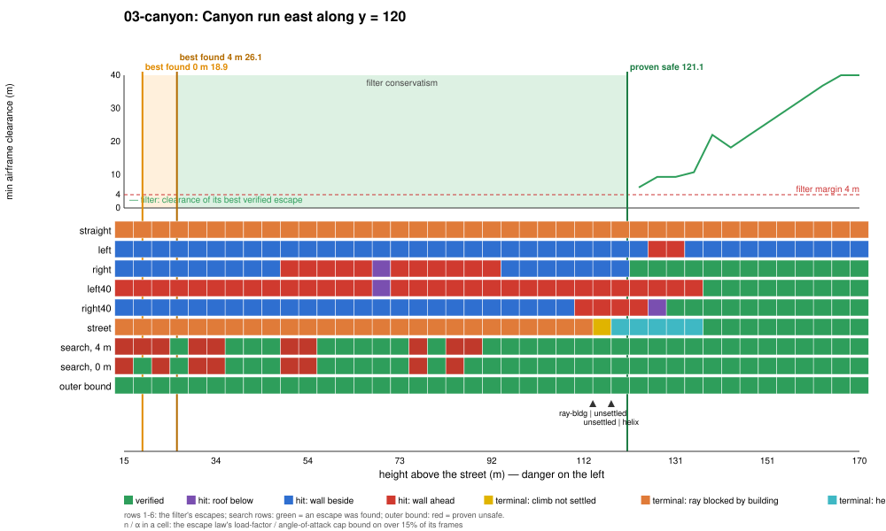

# Regime 3: canyon

**What it is.** The aircraft is flying down a street below the roofs. The street is too narrow to turn in (28 m wide; a 40° turn at 45 m/s needs a radius of about 240 m), so every way out goes along the street and up. Nothing ahead is close: the street is open for 1.6 km. What decides it: the height below the roof line, the length of canyon ahead before a turn or climb-out fits, and the speed. Here the binding constraint is not an obstacle but the filter's **terminal sets**: the escapes do not hit anything until they try to turn, and the ones that keep going straight never reach a terminal set the filter can certify.

## Location

The street `y = 120` (28 m wide), flown east from `x = −470` toward downtown, 45 m/s, level, wings level. Its walls are intermittent: 81 to 196 m tall towers on both sides (`regimes near -600 200 92 148` lists them), broken every 120 m by cross streets and by the gaps between lots (`regimes canyons` found no 240 m stretch in the city where both walls stay above 60 m more than 65% of the way). Varied: height above the street, 15 to 170 m.

## Slice

| Proven safe | Best found, 4 m | Best found, 0 m | Proven unsafe | Filter conservatism | Cost of the 4 m margin | Outer-bound slack |
|---|---|---|---|---|---|---|
| 121.1 m | 26.1 m | 18.9 m | none | 94.9 m | 7.3 m | – |

The filter accepts only from 121 m up, at about the height of the walls near the start. The richer search finds escapes from 26 m up, but not at every height in between (none at 30.5, 49.9, 77.0 or 84.8 m on the grid): the street's geometry makes the best escape depend on where along the block the climb-out happens, and the search is not exhaustive.

**Binding causes along the slice.** Over the whole slice the straight escape fails its terminal test: its climbing ray's corridor widens 2% of the distance, so after a couple of hundred metres it is wider than the street and runs into the walls (`ray-bldg`). The street escape follows the street climbing, but until it is near roof height its helix annulus is never clear (`ray-bldg` below 112 m, `unsettled`/`helix` from 116 m). The turns hit the walls beside them (`wall-side`) or the walls of the cross street they turn into (`wall-ahead`, and `roof` near 70 m). The first escape to verify, at 121 m, is the right 30° turn; the 40° turns follow at 139 m.

**Where the conservatism is.** Almost all of it is the terminal-set requirement, not the escape manoeuvre: the search's programs (a few seconds of hard banked pulls to line up and climb, then the street escape) get out of the canyon by flying along it for longer (24 s horizon against 16 s) and climbing, which the filter's escapes also do, but only certify once a full helix fits. A terminal set that accepts "climbing along a straight, open street with walls on both sides" (a corridor terminal set) would be the lever here, worth up to 95 m on this slice. The outer bound proves nothing: the street is open, so a point mass can always keep flying along it.

<!-- DEMOS -->

<!-- WILD -->

## State of progress

- **Exact:** escapes flown on the bit-exact JSBSim port.
- **Numerical:** clearance at 1/16 s samples; the terminal sets (ray corridor, helix annulus) on the settled rollout. These are what bind here.
- **Formally proved:** nothing for this regime.
- **Main lever:** a corridor terminal set for open streets (or a longer horizon with a street-following climb), up to 95 m. No outer bound exists for an open canyon without a model of where the street ends.
