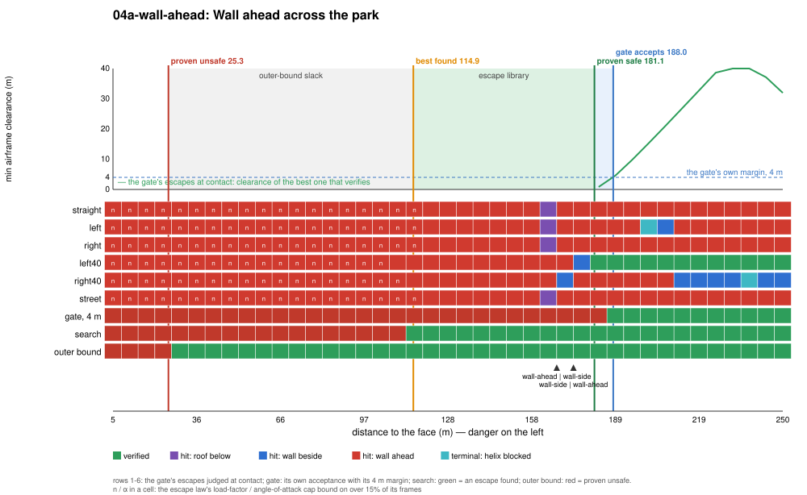
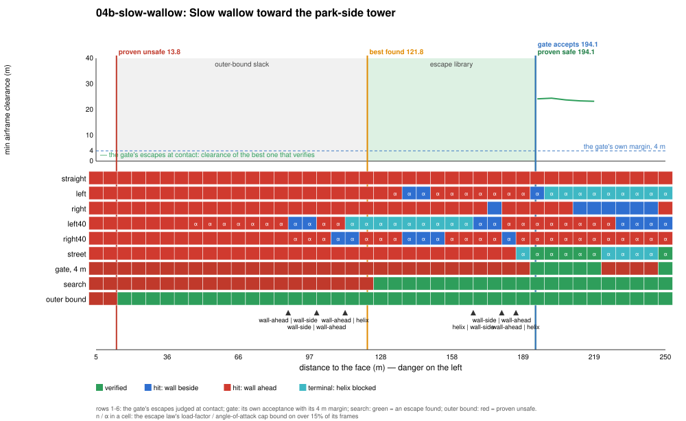
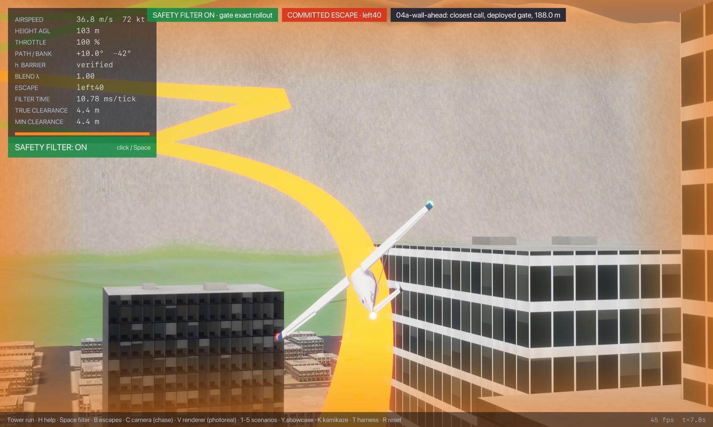
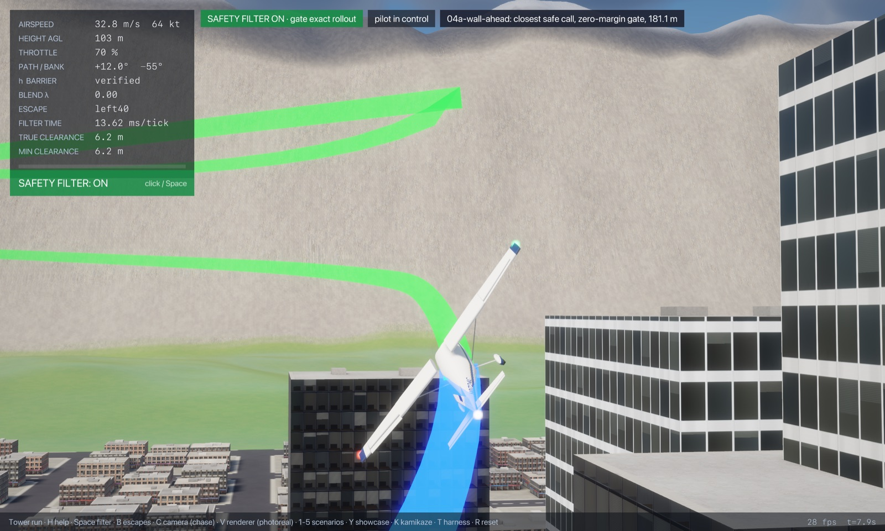
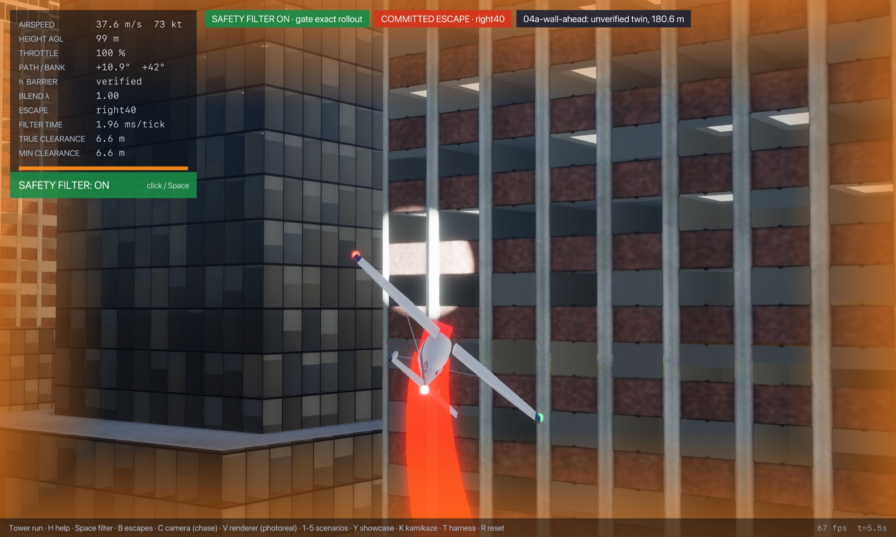
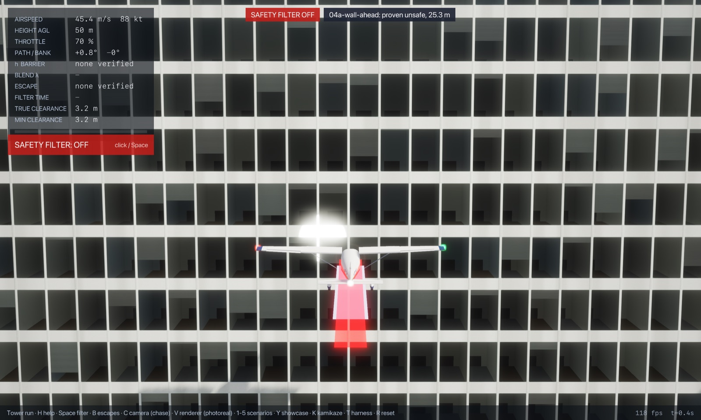
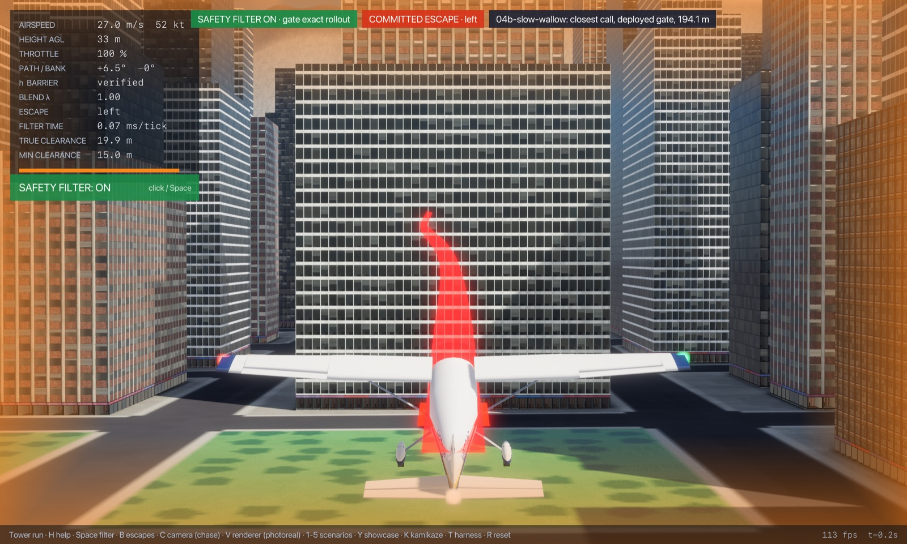
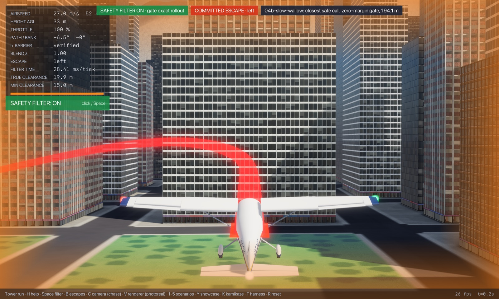
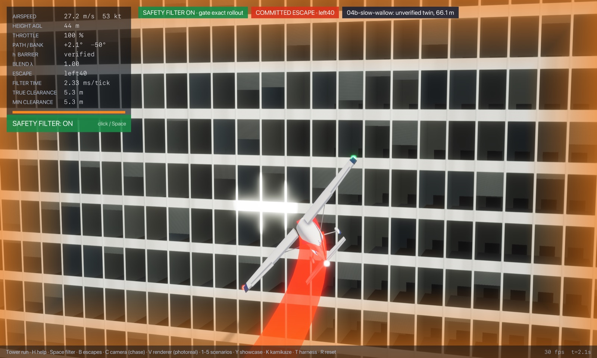
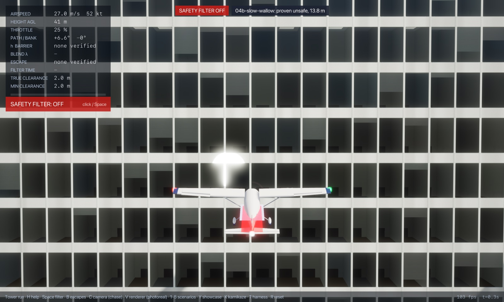

# Regime 4: wall or tower ahead

**What it is.** A tower face is dead ahead, too tall to climb over in the distance left. The way out is to turn away (or pull up and over, if the roof is low enough), and what decides it is the distance to the face, the closing angle and the speed, which sets the turn radius. At 45 m/s the c172 reaches its α limit at about 2.8 g, so a turn needs about 80 m of radius plus the roll-in.

The slow wallow at the same tower (`04b`, a first-pass "low-speed envelope" slice) ends in contact with the face, so it is here now; at 27 m/s the escapes' turns run on the escape law's α cap, a design choice of the filter rather than a safety limit.

## Location

The park-side tower (box `x ∈ [−218.1, −186.2]`, `y ∈ [255.8, 334.5]`, 87 m tall, setback tiers of 129 m and 157 m behind it), approached head-on across the open park along `y = 295` (40 m from the face's north end, 39 m from its south end), heading east.

| Slice | Fixed | Varied |
|---|---|---|
| `04a-wall-ahead` | 50 m above the ground, 45 m/s, level, wings level | distance from the aircraft's centre to the face, 5 to 250 m |
| `04b-slow-wallow` | 40 m above the ground, 27 m/s, flight path +6°, throttle 0.25 | the same distance, 5 to 250 m |

## Slices





| Slice | Gate accepts (its 4 m margin) | Proven safe (contact) | Best found (contact) | Proven unsafe | Gate's own margin | Escape library and terminal sets | Outer-bound slack |
|---|---|---|---|---|---|---|---|
| head-on, 45 m/s (m) | 188.0 | 181.1 | 114.9 | 25.3 | 6.9 | 66.2 | 89.6 |
| slow wallow, 27 m/s (m) | 194.1 | 194.1 | 121.8 | 13.8 | 0.0 | 72.4 | 108.0 |

**Binding causes along the slices** (at contact). Inside the markers every escape hits the face ahead (`wall-ahead`), with the load-factor cap binding closer than about 110 m at 45 m/s and the α cap binding on the turns at 27 m/s. Near the markers a few escapes clip the face beside them instead as they turn away (`wall-side`), and at 164 m (45 m/s) the climbing escapes hit the 87 m roof: that is where a pull-up over the roof stops being an option. At 45 m/s only the left 40° turn verifies, from 181 m. At 27 m/s only the street escape does, from 194 m, and not monotonically: the gate rejects 225 to 244 m and accepts again at 250 m.

**Where the gap is.** The gate's margin costs 6.9 m at 45 m/s and nothing at 27 m/s (there the boundary is set by the street escape's helix test, which fails just inside it, not by clearance). The big gap is the escape library: 66 m and 72 m. The library's turns roll in only once the climb is established (the 40° turns as soon as the flight path is 1.7° up, the 30° turns after at least 1.5 s), at the shared roll gains, and hold 30° or 40°. The search's best programs roll straight into a 70° to 80° bank (45 m/s: 3.3 g for 0.3 s, then 2.5 g for 3 s; 27 m/s: 73° at 2.2 g for 1 s) before a 41° to 53° climbing turn: a hard level break-turn. The outer bound proves unsafety only within 25 m (45 m/s) and 14 m (27 m/s), 4.5 and 9 times closer than the best found: it lets the point mass turn at `(lift + g) / V` in any direction at once, with no roll-in, and its stall bound (15% above the plant's largest measured lift per dynamic pressure) is generous.

<!-- DEMOS -->
## Demos (run from `flight/`)

### Demo: Wall ahead across the park (04a-wall-ahead)

**Closest safe call** (the proven-safe state; the gate with its margin set to zero and clearance checked every frame, `--margin 0 --check-every 1`; pilot lead-in 2.00 s with the sticks released, so the fly-by-wire holds flight path and bank into the obstacle):

```sh
cargo run --release --features jsb -- --safety-filter exact-rollout --time-cap 0 --margin 0 --check-every 1 --start -399.19,295.00,57.49,45.00,0.000,0.000,0.000,0.70 --lead 2 --cinematic --cam 0 --paths --label "04a-wall-ahead: closest safe call, zero-margin gate, 181.1 m"
```

- filter on: no crash; closest pass during the save **6.33 m** at t = 7.9 s; minimum over 25 s 4.28 m (filter takes over at t = 0.2 s, hands back at 0.2 s, 21 takeovers in all)
- filter off (`--off`): **crashes** at t = 5.8 s (filter never takes over; start not verified)

**Just-barely-unsafe twin**: 0.5 m closer than the proven-safe marker, no lead-in, same zero-margin gate. No escape verifies at the start, so the gate commits blind to the escape that got farthest:

```sh
cargo run --release --features jsb -- --safety-filter exact-rollout --time-cap 0 --margin 0 --check-every 1 --start -398.69,295.00,57.49,45.00,0.000,0.000,0.000,0.70 --cinematic --cam 0 --paths --label "04a-wall-ahead: unverified twin, 180.6 m"
```

- filter on: **crashes** at t = 5.8 s (filter takes over at t = 0.0 s; start not verified)

**The deployed gate (4 m margin)** from its own acceptance marker (lead-in 1.75 s):

```sh
cargo run --release --features jsb -- --safety-filter exact-rollout --time-cap 0 --start -406.08,295.00,57.50,45.00,0.000,0.000,0.000,0.70 --lead 1.75 --cinematic --cam 0 --paths --label "04a-wall-ahead: closest call, deployed gate, 188.0 m"
```

- filter on: no crash; closest pass during the save **14.38 m** at t = 7.6 s; minimum over 25 s 6.60 m (filter takes over at t = 1.7 s, hands back at 1.8 s, 19 takeovers in all)
- filter off: **crashes** at t = 5.7 s (filter never takes over; start not verified)

**Closest proven-unsafe call**:

```sh
cargo run --release --features jsb -- --safety-filter exact-rollout --time-cap 0 --start -243.39,295.00,56.83,45.00,0.000,0.000,0.000,0.70 --cinematic --cam 0 --paths --label "04a-wall-ahead: proven unsafe, 25.3 m"
cargo run --release --features jsb -- --safety-filter exact-rollout --time-cap 0 --start -243.39,295.00,56.83,45.00,0.000,0.000,0.000,0.70 --cinematic --cam 0 --paths --off --label "04a-wall-ahead: proven unsafe, 25.3 m"
```

- filter on: **crashes** at t = 0.5 s (filter takes over at t = 0.0 s; start not verified)
- filter off: **crashes** at t = 0.5 s (filter never takes over; start not verified)
- the gate's escapes flown with no margin: 6 of 6 touch (straight hits at 0.5 s, left hits at 0.5 s, right hits at 0.5 s, left40 hits at 0.5 s, right40 hits at 0.5 s, street hits at 0.5 s)


   

### Demo: Slow wallow toward the park-side tower (04b-slow-wallow)

**Closest safe call** (the proven-safe state; the gate with its margin set to zero and clearance checked every frame, `--margin 0 --check-every 1`; pilot lead-in 2.50 s with the sticks released, so the fly-by-wire holds flight path and bank into the obstacle):

```sh
cargo run --release --features jsb -- --safety-filter exact-rollout --time-cap 0 --margin 0 --check-every 1 --start -412.21,295.00,47.51,27.00,6.000,0.000,0.000,0.25 --lead 2.5 --cinematic --cam 0 --paths --label "04b-slow-wallow: closest safe call, zero-margin gate, 194.1 m"
```

- filter on: no crash; closest pass during the save **15.63 m** at t = 0.0 s; minimum over 25 s 0.00 m (filter takes over at t = 0.0 s, hands back at 7.3 s, 29 takeovers in all)
- filter off (`--off`): **crashes** at t = 10.6 s (filter never takes over; start not verified)

**Just-barely-unsafe twin**: 128.0 m closer than the proven-safe marker, no lead-in, same zero-margin gate. No escape verifies at the start, so the gate commits blind to the escape that got farthest:

```sh
cargo run --release --features jsb -- --safety-filter exact-rollout --time-cap 0 --margin 0 --check-every 1 --start -284.21,295.00,47.07,27.00,6.000,0.000,0.000,0.25 --cinematic --cam 0 --paths --label "04b-slow-wallow: unverified twin, 66.1 m"
```

- filter on: **crashes** at t = 2.3 s (filter takes over at t = 0.0 s; start not verified)

**The deployed gate (4 m margin)** from its own acceptance marker (lead-in 2.50 s):

```sh
cargo run --release --features jsb -- --safety-filter exact-rollout --time-cap 0 --start -412.21,295.00,47.51,27.00,6.000,0.000,0.000,0.25 --lead 2.5 --cinematic --cam 0 --paths --label "04b-slow-wallow: closest call, deployed gate, 194.1 m"
```

- filter on: no crash; closest pass during the save **15.63 m** at t = 0.0 s; minimum over 25 s 3.99 m (filter takes over at t = 0.0 s, hands back at 9.2 s, 41 takeovers in all)
- filter off: **crashes** at t = 10.6 s (filter never takes over; start not verified)

**Closest proven-unsafe call**:

```sh
cargo run --release --features jsb -- --safety-filter exact-rollout --time-cap 0 --start -231.90,295.00,46.75,27.00,6.000,0.000,0.000,0.25 --cinematic --cam 0 --paths --label "04b-slow-wallow: proven unsafe, 13.8 m"
cargo run --release --features jsb -- --safety-filter exact-rollout --time-cap 0 --start -231.90,295.00,46.75,27.00,6.000,0.000,0.000,0.25 --cinematic --cam 0 --paths --off --label "04b-slow-wallow: proven unsafe, 13.8 m"
```

- filter on: **crashes** at t = 0.3 s (filter takes over at t = 0.0 s; start not verified)
- filter off: **crashes** at t = 0.3 s (filter never takes over; start not verified)
- the gate's escapes flown with no margin: 6 of 6 touch (straight hits at 0.3 s, left hits at 0.3 s, right hits at 0.3 s, left40 hits at 0.3 s, right40 hits at 0.3 s, street hits at 0.3 s)


   
<!-- /DEMOS -->

<!-- WILD -->
## In the wild

Of the 22100 commit runs (filter takeovers) in the 200 hostile-pilot harness episodes, 298 in 91 episodes fall in this regime (classified by the cause of the escape that got farthest, judged as the deployed gate judges it, with its 4 m margin, from the state where it rejected the pilot; `regimes wild`, `wild.csv`): wall ahead 298.

The three closest saves (lowest airframe clearance during the takeover):

| Episode | Takeover at | Cause | Airspeed | Closest pass | Replay (from `flight/`) |
|---|---|---|---|---|---|
| 59 | t = 47.1 s | wall ahead | 59 m/s | 3.9 m | `cargo run --release --features jsb -- --safety-filter exact-rollout --time-cap 0 --episode 59 --paths --cinematic --cam 0` |
| 67 | t = 30.0 s | wall ahead | 67 m/s | 3.9 m | `cargo run --release --features jsb -- --safety-filter exact-rollout --time-cap 0 --episode 67 --paths --cinematic --cam 0` |
| 54 | t = 8.1 s | wall ahead | 48 m/s | 3.9 m | `cargo run --release --features jsb -- --safety-filter exact-rollout --time-cap 0 --episode 54 --paths --cinematic --cam 0` |
<!-- /WILD -->

## State of progress

- **Exact:** escapes flown on the bit-exact JSBSim port, contact checked at every frame.
- **Numerical:** terminal sets on the settled rollout (a proof device, not part of the objective).
- **Formally proved:** The Lean port of this gate (`CityGate`, flown with `--safety-filter exact-rollout-lean`) is proved safe in the objective's sense (`CityGate.city_safe`), assuming its end-of-escape test means safe forever (`TermSound`), with its own contact test (a 6 m cube in exact arithmetic, every frame); see `notes/lean-city-gate.md`. This study maps the Rust gate (`--safety-filter exact-rollout`), whose floating-point sphere-and-capsule clearance is not certified, so the Lean gate's own boundaries (its larger keep-out may make it intervene earlier) are not mapped here.
- **Main lever:** the escape library: a hard break-turn escape is worth 66 to 72 m here; the margin is worth at most 7 m. The outer bound would tighten by charging the turn for supporting the aircraft's weight and by modelling the roll-in.
