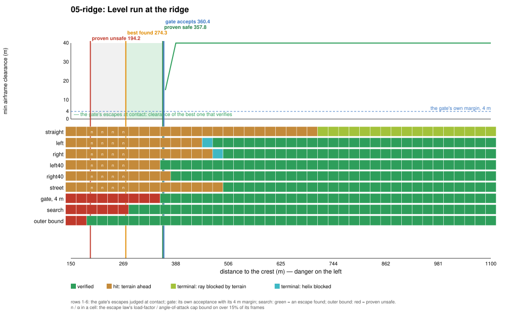
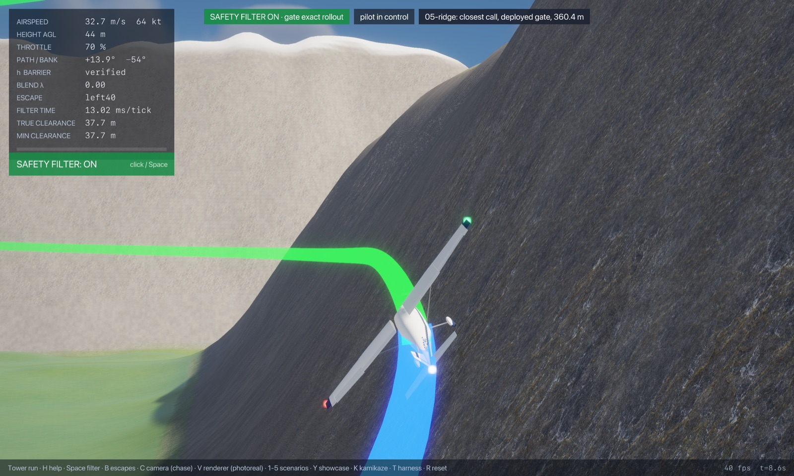
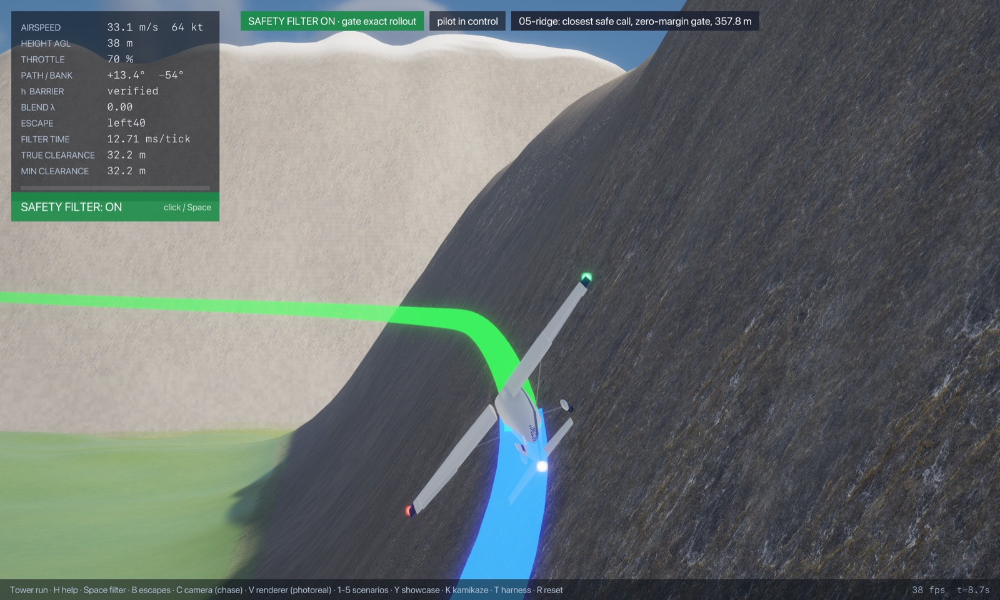
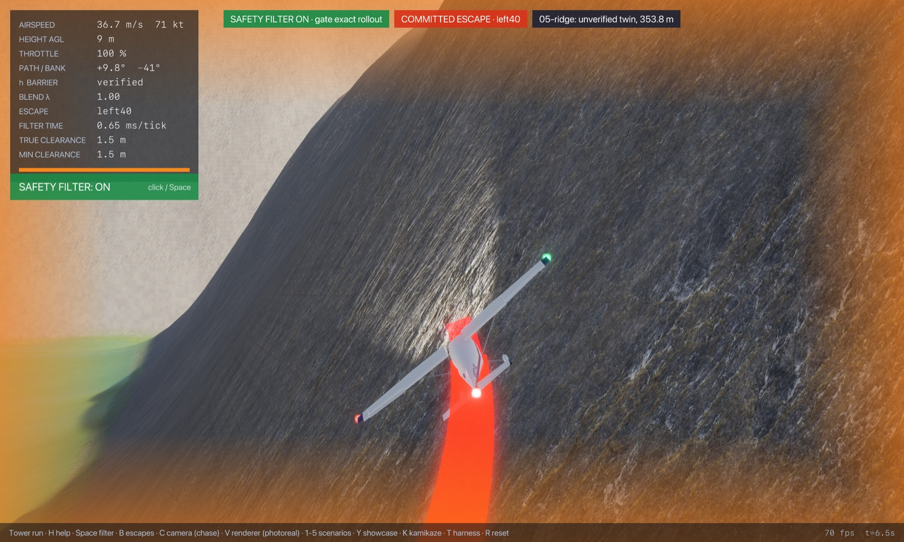
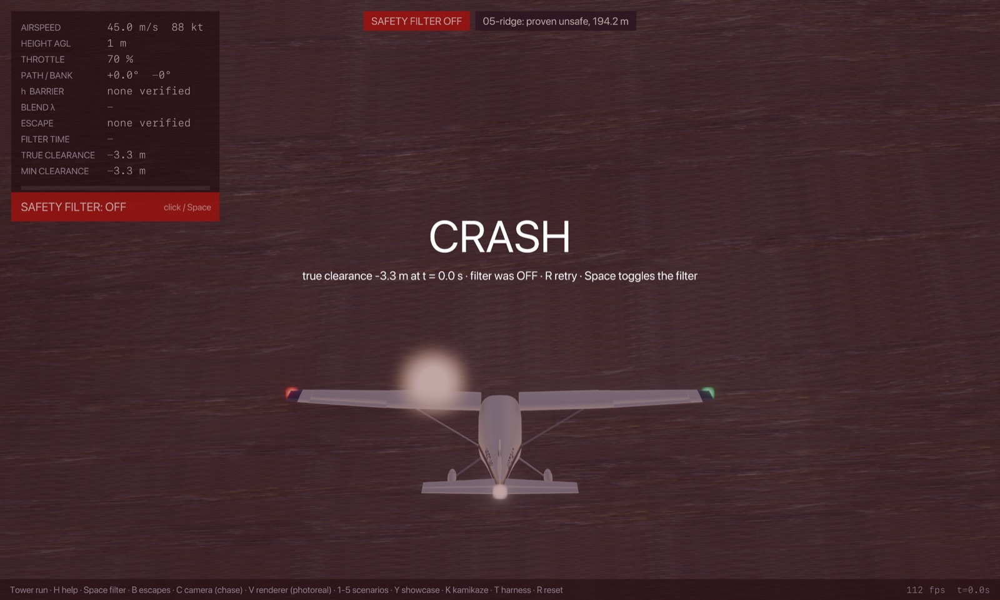

# Regime 5: climb-out against rising terrain

(Regime 7 in the first pass; renumbered once the two envelope regimes left the list.)

**What it is.** The aircraft is flying level toward a ridge it cannot out-climb in the distance left; the way out is to turn back across the valley before the slope arrives, or to start the climb early enough. What decides it: the distance to the slope, the height deficit to the crest, and the climb performance at the speed flown. Every escape that fails hits the slope ahead (`terrain-ahead`).

## Location

The inner ridge south of the city (crest line `y = −2050`, about 285 m above the valley, Gaussian cross-section with a 150 m width scale, running `|x| < 1500`). Flown south along `x = 150` at a fixed altitude, 60 m above the valley floor 900 m north of the crest (so the slope rises toward the aircraft as it closes), 45 m/s, level, wings level. Varied: distance to the crest line, 150 to 1100 m.

## Slice



| Gate accepts (its 4 m margin) | Proven safe (contact) | Best found (contact) | Proven unsafe | Gate's own margin | Escape library and terminal sets | Outer-bound slack |
|---|---|---|---|---|---|---|
| 360.4 m | 357.8 m | 274.3 m | 194.2 m | 2.6 m | 83.5 m | 80.2 m |

**Binding causes along the slice** (at contact). Inside 358 m every escape hits the slope ahead, with the load-factor cap binding closer than about 290 m. The 40° turns verify first (left from 358 m, right from 388 m), then the 30° turns and the street escape from about 480 to 510 m. The straight escape never verifies against the ridge: it hits the slope out to 700 m, and beyond that its climbing ray is blocked by the ridge itself (`ray-terrain`).

**Where the gap is.** The gate's margin is worth only 2.6 m here. The escape library is worth 84 m: the search's best program rolls straight into a 78° bank at 4.9 g, holds 66° at 4.1 g for 2 s (a level break-turn back across the valley), rolls out and then climbs in a 44° turn, where the library's 40° turns wait for the climb to establish before rolling in. Same lever as regime 4. The outer bound proves unsafety out to 194 m, 80 m short of the best found: the ridge is wide and long, so the crossing test's disk fits inside it, which makes this the bound's most useful slice.

<!-- DEMOS -->
## Demos (run from `flight/`)

### Demo: Level run at the ridge (05-ridge)

**Closest safe call** (the proven-safe state; the gate with its margin set to zero and clearance checked every frame, `--margin 0 --check-every 1`; pilot lead-in 3.00 s with the sticks released, so the fly-by-wire holds flight path and bank into the obstacle):

```sh
cargo run --release --features jsb -- --safety-filter exact-rollout --time-cap 0 --margin 0 --check-every 1 --start 150.00,-1692.19,66.71,45.00,0.000,-90.000,0.000,0.70 --lead 3 --cinematic --cam 0 --paths --label "05-ridge: closest safe call, zero-margin gate, 357.8 m"
```

- filter on: no crash; closest pass during the save **32.24 m** at t = 8.7 s; minimum over 25 s 32.24 m (filter takes over at t = 2.9 s, hands back at 4.1 s, 6 takeovers in all)
- filter off (`--off`): **crashes** at t = 6.4 s (filter never takes over; start not verified)

**Just-barely-unsafe twin**: 4.0 m closer than the proven-safe marker, no lead-in, same zero-margin gate. No escape verifies at the start, so the gate commits blind to the escape that got farthest:

```sh
cargo run --release --features jsb -- --safety-filter exact-rollout --time-cap 0 --margin 0 --check-every 1 --start 150.00,-1696.19,66.71,45.00,0.000,-90.000,0.000,0.70 --cinematic --cam 0 --paths --label "05-ridge: unverified twin, 353.8 m"
```

- filter on: **crashes** at t = 6.7 s (filter takes over at t = 0.0 s; start not verified)

**The deployed gate (4 m margin)** from its own acceptance marker (lead-in 3.00 s):

```sh
cargo run --release --features jsb -- --safety-filter exact-rollout --time-cap 0 --start 150.00,-1689.59,66.71,45.00,0.000,-90.000,0.000,0.70 --lead 3 --cinematic --cam 0 --paths --label "05-ridge: closest call, deployed gate, 360.4 m"
```

- filter on: no crash; closest pass during the save **37.67 m** at t = 8.6 s; minimum over 25 s 37.67 m (filter takes over at t = 2.9 s, hands back at 3.5 s, 6 takeovers in all)
- filter off: **crashes** at t = 6.5 s (filter never takes over; start not verified)

**Closest proven-unsafe call**:

```sh
cargo run --release --features jsb -- --safety-filter exact-rollout --time-cap 0 --start 150.00,-1855.84,66.71,45.00,0.000,-90.000,0.000,0.70 --cinematic --cam 0 --paths --label "05-ridge: proven unsafe, 194.2 m"
cargo run --release --features jsb -- --safety-filter exact-rollout --time-cap 0 --start 150.00,-1855.84,66.71,45.00,0.000,-90.000,0.000,0.70 --cinematic --cam 0 --paths --off --label "05-ridge: proven unsafe, 194.2 m"
```

- filter on: **crashes** at t = 0.0 s (filter takes over at t = 0.0 s; start not verified)
- filter off: **crashes** at t = 0.0 s (filter never takes over; start not verified)
- the gate's escapes flown with no margin: 6 of 6 touch (straight hits at 0.0 s, left hits at 0.0 s, right hits at 0.0 s, left40 hits at 0.0 s, right40 hits at 0.0 s, street hits at 0.0 s)


   
<!-- /DEMOS -->

<!-- WILD -->
## In the wild

Of the 2996 commit runs (filter takeovers) in the 200 hostile-pilot harness episodes, 742 in 165 episodes fall in this regime (classified by the cause of the escape that got farthest, judged as the deployed gate judges it, with its 4 m margin, from the state where it rejected the pilot; `regimes wild`, `wild.csv`): ray blocked by terrain 656, terrain ahead 86.

The three closest saves (lowest airframe clearance during the takeover):

| Episode | Takeover at | Cause | Airspeed | Closest pass | Replay (from `flight/`) |
|---|---|---|---|---|---|
| 146 | t = 45.6 s | ray blocked by terrain | 49 m/s | 3.9 m | `cargo run --release --features jsb -- --safety-filter exact-rollout --time-cap 0 --episode 146 --check-threads 0 --paths --cinematic --cam 0` |
| 41 | t = 55.0 s | ray blocked by terrain | 32 m/s | 4.0 m | `cargo run --release --features jsb -- --safety-filter exact-rollout --time-cap 0 --episode 41 --check-threads 0 --paths --cinematic --cam 0` |
| 30 | t = 42.7 s | ray blocked by terrain | 41 m/s | 4.0 m | `cargo run --release --features jsb -- --safety-filter exact-rollout --time-cap 0 --episode 30 --check-threads 0 --paths --cinematic --cam 0` |
<!-- /WILD -->

## State of progress

- **Exact:** escapes flown on the bit-exact JSBSim port; terrain is the renderer's triangulated 20 m grid, checked along the wing and body at every frame.
- **Numerical:** terminal sets (the helix annulus clear of the ridge) on the settled rollout.
- **Formally proved:** The Lean port of this gate (`CityGate`, flown with `--safety-filter exact-rollout-lean`) is proved safe in the objective's sense (`CityGate.city_safe`), assuming its end-of-escape test means safe forever (`TermSound`), with its own contact test (a 6 m cube in exact arithmetic, every frame); see `notes/lean-city-gate.md`. This study maps the Rust gate (`--safety-filter exact-rollout`), whose floating-point sphere-and-capsule clearance is not certified, so the Lean gate's own boundaries (its larger keep-out may make it intervene earlier) are not mapped here.
- **Main lever:** a break-turn escape (84 m). The outer bound brackets the boundary within 80 m here, its tightest bracket in the study.
