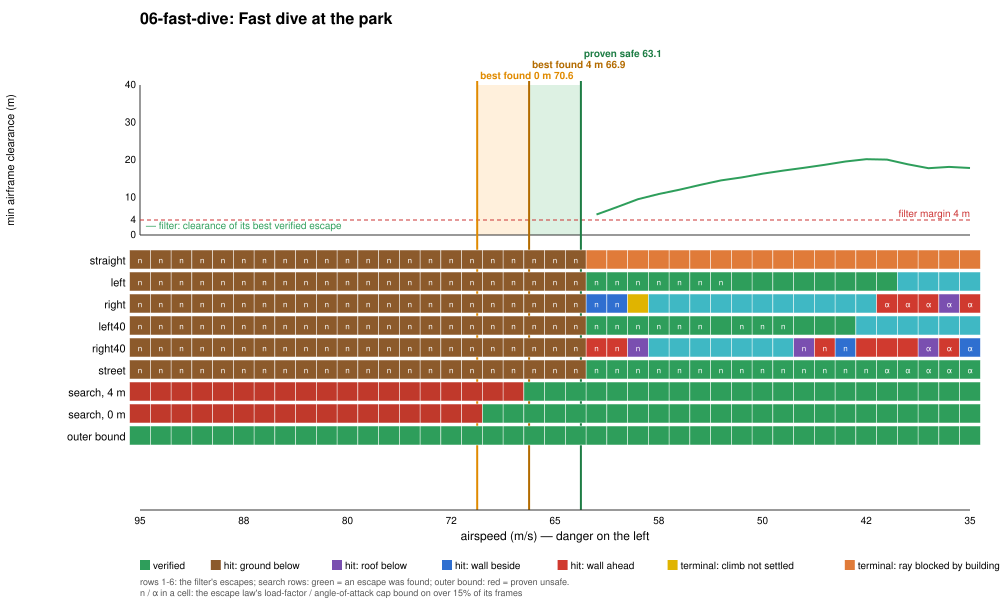

# Regime 6: high-speed envelope

**What it is.** A fast dive at a floor. The faster the aircraft, the wider its pull-out arc at a given load factor, and the load factor is capped: the escape law at 3.3 g (3.5 g in its default gains), the richer search at 3.8 g command and 4.0 g actual (the c172's +3.8 g limit load plus 5% overshoot), and the outer bound at 3.8 g. What decides it: airspeed, dive angle and height.

**Merged with regime 1 in substance.** The data shows this is the floor regime (1) seen along the speed axis: every failing escape hits the ground with the load-factor cap binding (`n` in every red cell), exactly as in the park dive of regime 1, which flies the same geometry at 50 m/s. The folder stays for the speed slice and because the binding limit here is the structural one: the JSBSim model itself has no structural limit and pulls 6.6 g at 66 m/s with full aft stick (`regimes calib`), so without the 4.0 g ceiling the richer search found escapes from faster dives (an earlier run without it reached 5.6 g).

## Location

The park dive of regime 1: over `(−360, 260)` in the 2×2-block park, heading north, 45 m above the park, dive −35°, wings level, throttle 0.6. Varied: airspeed, 35 to 95 m/s (danger on the left of the plot: faster).

## Slice

| Proven safe | Best found, 4 m | Best found, 0 m | Proven unsafe | Filter conservatism | Cost of the 4 m margin | Outer-bound slack |
|---|---|---|---|---|---|---|
| 63.1 m/s | 66.9 m/s | 70.6 m/s | none to 95 m/s | 3.8 m/s | 3.7 m/s | ≥ 24 m/s |

**Binding causes along the slice.** Faster than 63 m/s every escape hits the ground on its load-factor cap. Slower, the straight escape's terminal ray is blocked by the towers north of the park at every speed, and the 30° and right 40° turns fail on the towers around the park (`helix`, `wall-side`, `wall-ahead`, `roof`); the left 30° and 40° turns and the street escape verify.

**Where the conservatism is.** 3.8 m/s to the best found with the same margin: the search's program is a 15° left turn on the aggressive law (load factor up to 3.8 g where the filter's law stops at 3.5 g). The margin costs another 3.7 m/s. The outer bound proves nothing up to 95 m/s: at 95 m/s the descent rate is 54 m/s, and a point mass pulling 3.8 g plus 7.1 m/s² of thrust (34.6 m/s² net upward) stops it in 42 m, inside the 45 m available. The c172's Vne is about 84 m/s, so the slack is at least 24 m/s and the bound cannot close it in the flight envelope.

<!-- DEMOS -->

<!-- WILD -->

## State of progress

- **Exact:** escapes flown on the bit-exact JSBSim port.
- **Numerical:** clearance at 1/16 s samples; terminal sets on the settled rollout.
- **Formally proved:** the longitudinal envelope theorem of `Envelope/` (see regime 1) is the closest formal work; its pull-up performance per airspeed band is an assumption the plant must obey, checked at run time.
- **Main lever:** the escape law's load-factor cap (3.5 g against the 3.8 g limit load), then the margin. A structural limit is a hard ceiling here: past it, no escape is legitimate however the search is improved.
