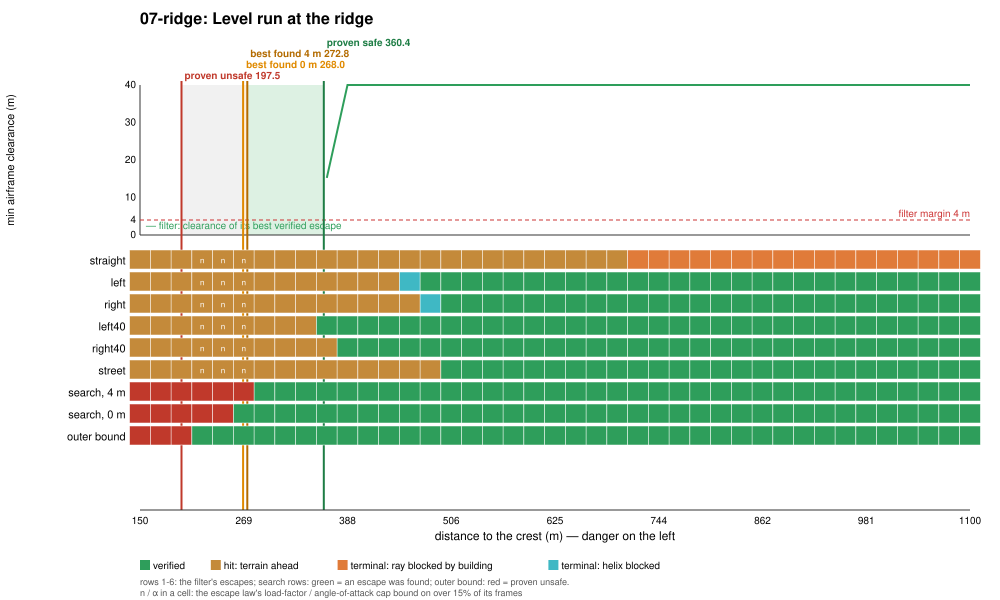

# Regime 7: climb-out against rising terrain

**What it is.** The aircraft is flying level toward a ridge it cannot out-climb in the distance left; the way out is to turn back across the valley before the slope arrives, or to start the climb early enough. What decides it: the distance to the slope, the height deficit to the crest, and the climb performance at the speed flown. Every failing escape hits the slope ahead (`terrain-ahead`), and closer than about 290 m the load-factor cap binds too.

## Location

The inner ridge south of the city (crest line `y = −2050`, about 285 m above the valley, Gaussian cross-section with a 150 m width scale, running `|x| < 1500`). Flown south along `x = 150` at a fixed altitude 60 m above the valley floor 900 m north of the crest (so the slope rises ahead of the aircraft as it closes), 45 m/s, level, wings level. Varied: distance to the crest line, 150 to 1100 m. The ridge is the highest terrain between the city and the map rim, and the rim (780 to 910 m) is what the straight escape's climbing ray finally runs into far from the ridge (`ray-bldg` beyond 720 m in the plot means the ray met the city's towers north of the valley first).

## Slice

| Proven safe | Best found, 4 m | Best found, 0 m | Proven unsafe | Filter conservatism | Cost of the 4 m margin | Outer-bound slack |
|---|---|---|---|---|---|---|
| 360.4 m | 272.8 m | 268.0 m | 197.5 m | 87.6 m | 4.8 m | 70.5 m |

**Binding causes along the slice.** Inside 360 m every escape hits the slope ahead. The 40° turns verify first (left from 360 m, right from 388 m), then the 30° turns and the street escape from about 480 to 510 m; the straight escape never verifies against the ridge (it hits the slope out to 700 m, and beyond that its ray is blocked by the towers behind it... ahead of it, north of the valley it would have to climb over).

**Where the conservatism is.** 88 m to the best found with the same margin: the search's program rolls straight into a 73° bank at up to 3.7 g for 3 s (a level break-turn back across the valley) and then climbs in a 26° turn; the library's 40° turns wait for the climb to establish before rolling in, and then turn at 40°. Same lever as regime 4: a hard break-turn escape. The margin costs only 4.8 m. The outer bound is the most meaningful of all slices here: it proves unsafety out to 197.5 m, within 70 m of the best found, because the ridge is wide and long, so the crossing test's disk fits inside it.

<!-- DEMOS -->

<!-- WILD -->

## State of progress

- **Exact:** escapes flown on the bit-exact JSBSim port; terrain is the renderer's triangulated 20 m grid, checked exactly along the wing and body.
- **Numerical:** clearance at 1/16 s samples; terminal sets (helix annulus clear of the ridge) on the settled rollout.
- **Formally proved:** `Envelope/` (regime 1) is longitudinal and terrain-only, the closest in kind to this regime, but its escape is a straight climb; it says nothing about turning back.
- **Main lever:** a break-turn escape (88 m). The outer bound is within 70 m of the best found, the tightest bracket of the study.
