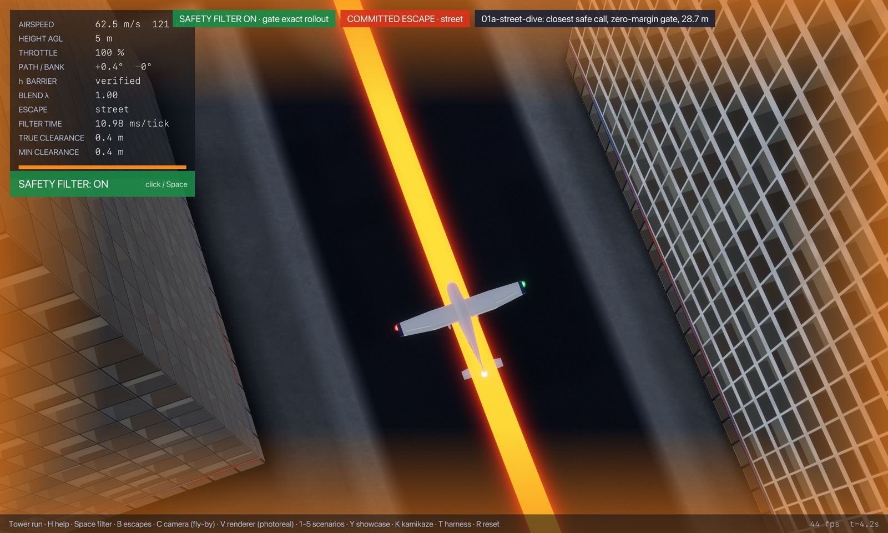
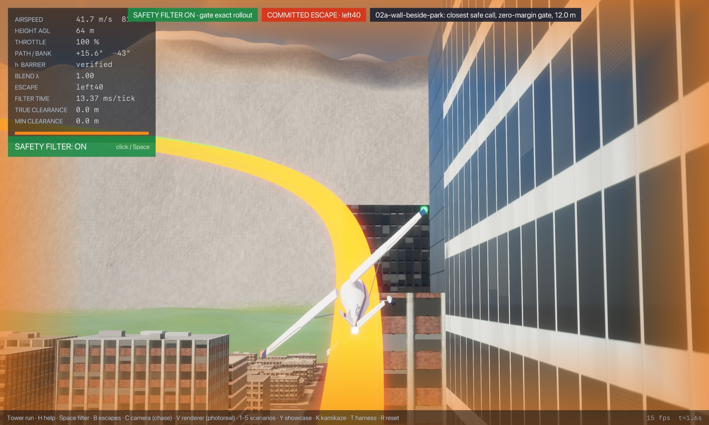
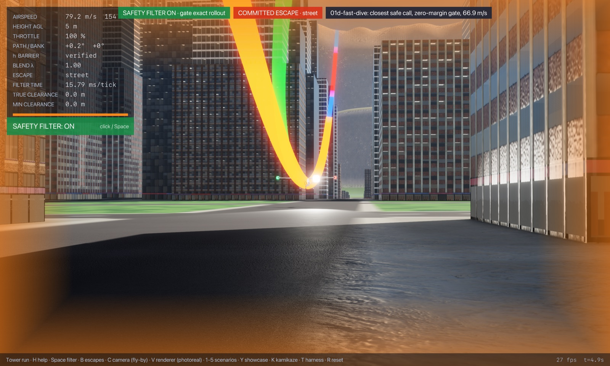
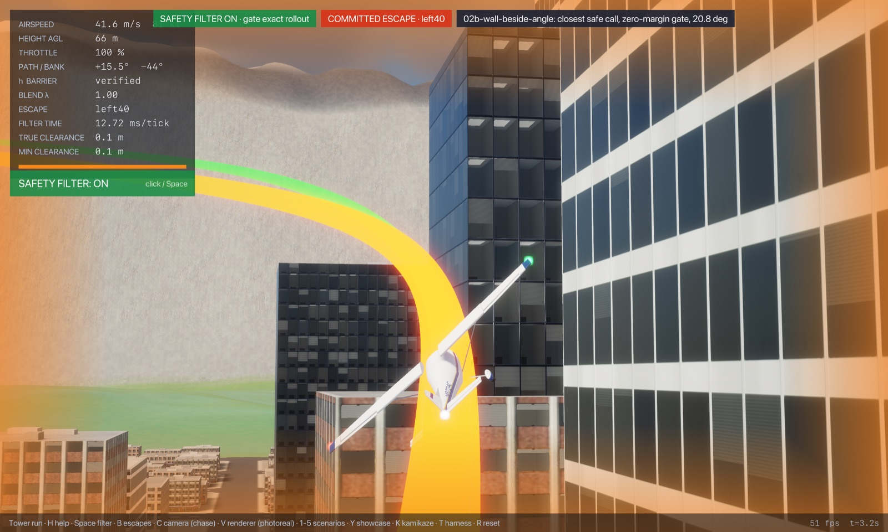
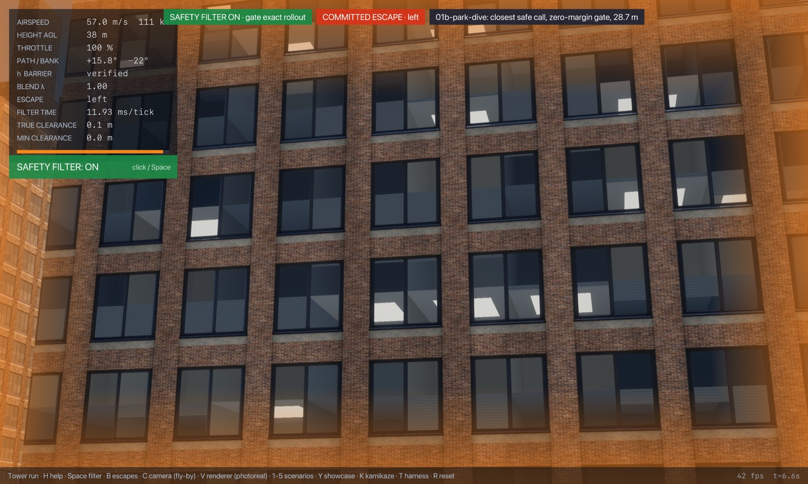
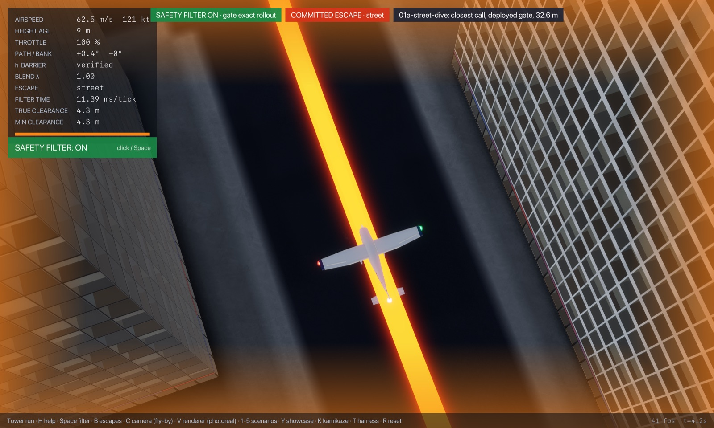
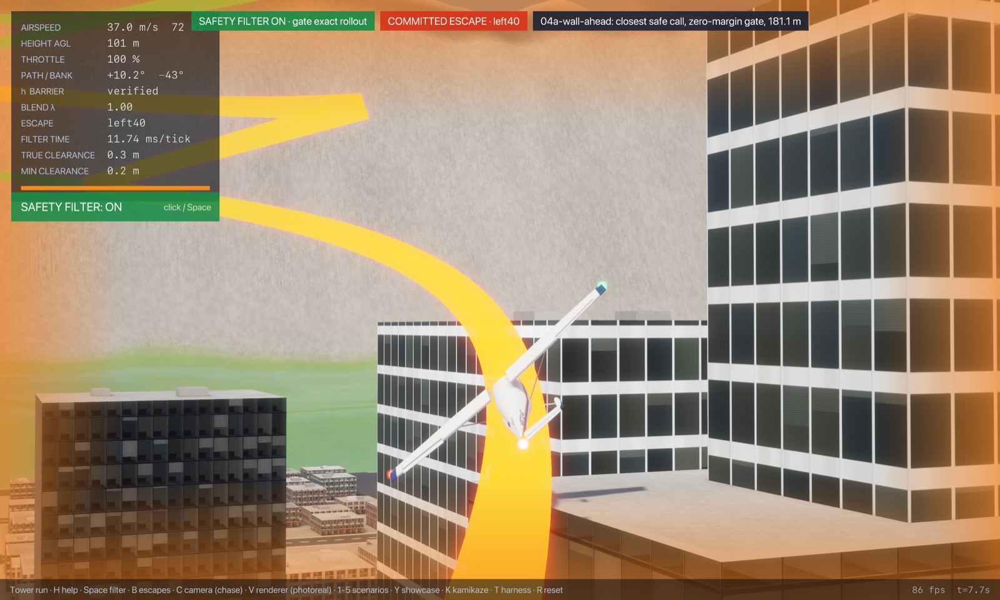

# Showcase: just-barely-saved flights

Seven demos, in suggested viewing order. In each the pilot lets go of the sticks while heading for the obstacle (the fly-by-wire then holds the flight path and bank, straight into it), and the gate filter takes over at the last moment. Unless marked otherwise, the gate runs with its margin set to zero and clearance checked at every JSBSim frame (`--margin 0 --check-every 1`): the filter that matches the safety objective, where only actual contact counts. Each start is the closest state on its slice from which one of the gate's own escapes avoids contact (the "proven safe" marker), so the save is as close as the gate's escapes allow; the twin listed under it starts a hair closer and crashes with the filter on.

Run the commands from `flight/` (after `(cd .. && lake build libcityjsb)`). The HUD shows the true and the minimum airframe clearance. Clearance is measured from the gate's airframe envelope, which encloses the aircraft (a 4.5 m sphere round the centre of gravity, plus a 0.8 m-radius capsule along the wing), so the airframe itself passes a little farther away than the HUD says: on the dives, a clearance of 0.01 m puts the centre of gravity 4.5 m above the floor, with the wheels about 3 m above it.

## 1. Into the Tower gap street



```sh
cargo run --release --features jsb -- --safety-filter exact-rollout --time-cap 0 --margin 0 --check-every 1 --start -120.00,-150.00,37.11,50.00,-30.000,90.000,0.000,0.60 --lead 3 --cinematic --paths --label "01a-street-dive: closest safe call, zero-margin gate, 28.7 m"
```

A 30° dive at 50 m/s into a 28 m street between 260 m and 290 m towers, pulled out by the street escape with **0.40 m** of clearance above the asphalt (filter off: it hits the street 3.5 s in). Starting 8 m lower instead (`--start -120.00,-150.00,29.11,…` in [the regime page](01-terrain-roof-below/README.md)), nothing verifies and it crashes 0.8 s later even with the filter on.

## 2. Wingtip against the glass



```sh
cargo run --release --features jsb -- --safety-filter exact-rollout --time-cap 0 --margin 0 --check-every 1 --start -230.10,265.00,56.98,45.00,0.000,80.000,0.000,0.70 --lead 0 --cinematic --cam 0 --paths --label "02a-wall-beside-park: closest safe call, zero-margin gate, 12.0 m"
```

Drifting 10° into an 87 m tower face from 12 m away at 45 m/s, the filter rolls away into its left 40° escape and the airframe envelope passes the glass with **0.03 m** to spare (filter off: it hits the face 0.7 s in). Half a metre closer, it hits the face 1.4 s after the start with the filter on.

## 3. A 67 m/s dive at the park



```sh
cargo run --release --features jsb -- --safety-filter exact-rollout --time-cap 0 --margin 0 --check-every 1 --start -360.00,260.00,52.40,66.88,-35.000,90.000,0.000,0.60 --lead 3 --cinematic --paths --label "01d-fast-dive: closest safe call, zero-margin gate, 66.9 m/s"
```

A 35° dive at 130 knots toward the park, pulled out **0.01 m** above the park between the towers (filter off: ground contact 3.8 s in). At 0.5 m/s faster no escape verifies and it crashes 1.7 s after the start with the filter on; the richer search, pulling up to 6.8 g, still finds a way out at 95 m/s, so the limit here is the escape law's 3.5 g cap.

## 4. Closing on the tower at a steeper angle



```sh
cargo run --release --features jsb -- --safety-filter exact-rollout --time-cap 0 --margin 0 --check-every 1 --start -243.10,265.00,57.05,45.00,0.000,69.190,0.000,0.70 --lead 1.5 --cinematic --cam 0 --paths --label "02b-wall-beside-angle: closest safe call, zero-margin gate, 20.8 deg"
```

From 25 m off the face, closing at 20.8°, the turn away clears the glass by **0.08 m** (filter off: contact 2.7 s in). At 21.3° the filter has no escape and the aircraft hits the face 1.7 s after the start.

## 5. Into the park



```sh
cargo run --release --features jsb -- --safety-filter exact-rollout --time-cap 0 --margin 0 --check-every 1 --start -360.00,260.00,36.14,50.00,-35.000,90.000,0.000,0.60 --lead 3 --cinematic --paths --label "01b-park-dive: closest safe call, zero-margin gate, 28.7 m"
```

The clean version of the dive: 35° at 50 m/s over open ground, a pull-out **0.04 m** above the park (filter off: ground contact 3.4 s in). Starting half a metre lower, it crashes 1.3 s in with the filter on.

## 6. The same street dive with the deployed gate



```sh
cargo run --release --features jsb -- --safety-filter exact-rollout --time-cap 0 --start -120.00,-150.00,40.98,50.00,-30.000,90.000,0.000,0.60 --lead 3 --cinematic --paths --label "01a-street-dive: closest call, deployed gate, 32.6 m"
```

The gate as shipped, with its 4 m margin, from the closest start it accepts (3.9 m higher than demo 1): the same pull-out, bottoming out at **4.27 m** of clearance. Demos 1 and 6 side by side show what the margin buys, and what it costs (3.9 m of height on this slice).

## 7. Head-on at the tower



```sh
cargo run --release --features jsb -- --safety-filter exact-rollout --time-cap 0 --margin 0 --check-every 1 --start -399.19,295.00,57.49,45.00,0.000,0.000,0.000,0.70 --lead 2 --cinematic --cam 0 --paths --label "04a-wall-ahead: closest safe call, zero-margin gate, 181.1 m"
```

Straight at an 87 m tower face across the park at 45 m/s: the filter takes over 2 s in and climbs away in a 40° left bank, skimming over the 87 m roof with **0.25 m** to spare (filter off: it hits the face 5.8 s in). Half a metre further in (180.6 m out, `--start -398.69,295.00,…` on [the regime page](04-wall-ahead/README.md)), nothing verifies and the blind fallback escape meets the face 5.8 s later. On this slice the richer search finds escapes from 115 m: the gap is the escape library, not physics.
