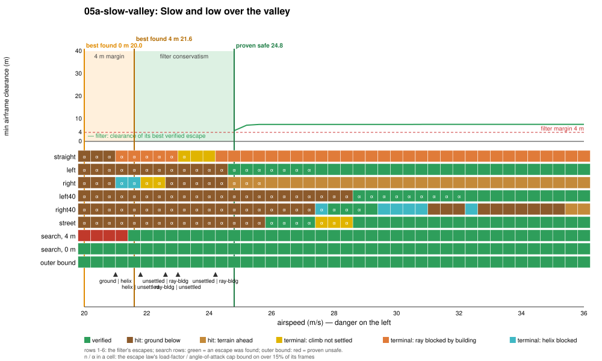
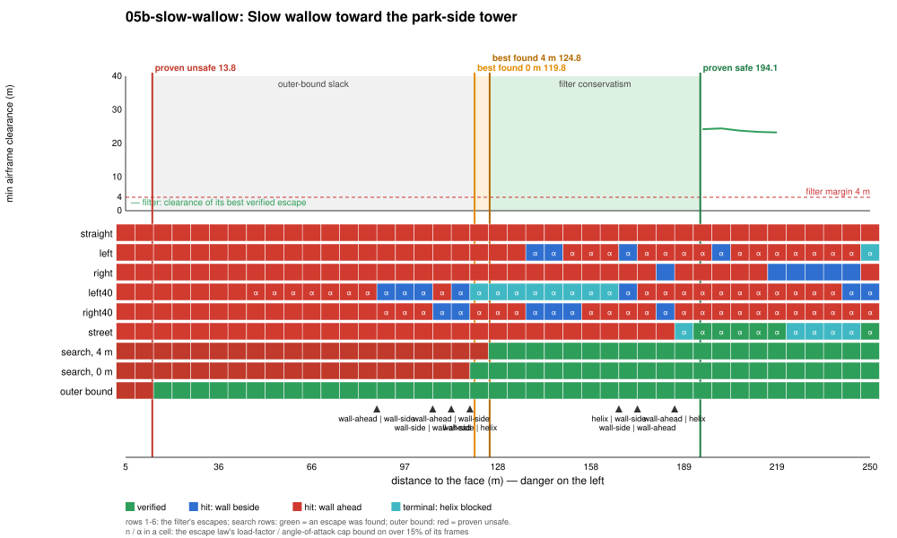

# Regime 5: low-speed envelope

> **Not a safety boundary under the current objective** (see [the appendix page](../README.md)). Kept as produced in the first pass: markers at the gate's 4 m margin, a 4.0 g ceiling on the search and 3.8 g in the outer bound.

**What it is.** The aircraft is slow, nose-high and at low power: the slow-flight trap. Pulling harder only raises the angle of attack toward the stall, so the escapes cannot turn or climb as they would at normal speed; they have to lower the nose and trade height for speed first. What decides it: the airspeed, the height available to trade, and the distance to whatever is ahead. The binding limit is the escape law's α cap (0.24 rad), marked `α` in the plots, not its load-factor cap.

The data splits this regime in two:

- **Pure envelope** (`05a`): open ground, nothing ahead but low hills; the floor is the only obstacle and the α cap is what binds.
- **Slow wallow at a tower** (`05b`): regime 4's wall ahead, flown at 27 m/s: the turns hit the face with the α cap binding. It is the low-speed side of regime 4, kept here because the binding limit differs (the α cap, not the load-factor cap).

## Locations

| Slice | Where | Fixed | Varied |
|---|---|---|---|
| `05a-slow-valley` | The valley south of the city, over `(0, −1600)`, heading east, 12 m above the ground. | flight path +8°, idle, wings level | airspeed, 20 to 36 m/s |
| `05b-slow-wallow` | The park-side tower of regime 4 (west face `x = −218.1`), approached east along `y = 295`, 40 m above the ground. | 27 m/s, flight path +6°, throttle 0.25 | distance to the face, 5 to 250 m |

The airspeed slice stops at 20 m/s because the plant's initial state (`JsbPlant::new`) does not start the c172 slower than that.

## Slices





| Slice | Proven safe | Best found, 4 m | Best found, 0 m | Proven unsafe | Filter conservatism | Cost of the 4 m margin | Outer-bound slack |
|---|---|---|---|---|---|---|---|
| slow valley (m/s) | 24.8 | 21.6 | ≤ 20.0 (slice floor) | none | 3.2 | ≥ 1.6 | – |
| slow wallow (m) | 194.1 | 124.8 | 119.8 | 13.8 | 69.3 | 5.0 | 106.0 |

**Binding causes along the slices.** In the valley, below 24.8 m/s every escape hits the ground with the α cap binding (the 40° left turn with both caps); between 21 and 24 m/s the straight escape instead fails its terminal test (`ray-bldg`, `unsettled`): it does not hit anything but never settles into a certifiable climb. The first escape to verify is the left 30° turn, still on its α cap. At the tower, every escape hits the face ahead, the turns on their α cap; only the street escape verifies, from 194 m. The filter's acceptance is not monotone there: it rejects 225 to 244 m and accepts again at 250 m, where the street escape's helix happens to be clear.

**Where the conservatism is.** In the valley the filter is 3.2 m/s from the best found: the search's best program is a gentle 15° left climbing turn with the aggressive law, which flies the slow aircraft at a higher α limit (0.26). At the tower the gap is 69 m, the same escape-library gap as regime 4 (the search's program is a short 60° roll-away at up to 3.6 g command, then a 39° turn), worse at low speed because the library's turns spend longer on their α cap. The outer bound proves nothing in the valley (a point mass at the stall bound can always level off within 12 m) and only 13.8 m from the tower face.

<!-- DEMOS -->
## Demos measured in the first pass (gate with its 4 m margin; run from `flight/`)

### Demo (first pass): Slow and low over the valley (05a-slow-valley)

**Closest proven-safe call** (pilot lead-in 0.00 s, sticks released: the fly-by-wire holds flight path and bank):

```sh
cargo run --release --features jsb -- --safety-filter exact-rollout --time-cap 0 --start 0.00,-1600.00,21.85,24.80,8.000,0.000,0.000,0.00 --lead 0 --cinematic --cam 0 --paths --label "Slow and low over the valley: closest proven-safe call, airspeed = 24.8 m/s"
```

- filter on: no crash; closest pass during the save **7.7 m** at t = 0.1 s; minimum over 25 s 4.0 m (filter takes over at t = 0.1 s, hands back at 0.1 s, 175 takeovers in all)
- filter off (`--off`): **crashes** at t = 5.8 s (filter never takes over; start not verified)

**Twin**: no start between the proven-safe marker and the outer bound crashed with the filter on (its blind fallback escape survived every one tried).


### Demo (first pass): Slow wallow toward the park-side tower (05b-slow-wallow)

**Closest proven-safe call** (pilot lead-in 2.50 s, sticks released: the fly-by-wire holds flight path and bank):

```sh
cargo run --release --features jsb -- --safety-filter exact-rollout --time-cap 0 --start -412.21,295.00,47.51,27.00,6.000,0.000,0.000,0.25 --lead 2.5 --cinematic --cam 0 --paths --label "Slow wallow toward the park-side tower: closest proven-safe call, distance to the face = 194.1 m"
```

- filter on: no crash; closest pass during the save **15.6 m** at t = 0.0 s; minimum over 25 s 4.0 m (filter takes over at t = 0.0 s, hands back at 9.2 s, 41 takeovers in all)
- filter off (`--off`): **crashes** at t = 10.6 s (filter never takes over; start not verified)

**Just-barely-unsafe twin**: 128.0 m closer than the proven-safe marker, no lead-in. The filter has no verified escape at the start, so it commits blind to the escape that got farthest:

```sh
cargo run --release --features jsb -- --safety-filter exact-rollout --time-cap 0 --start -284.21,295.00,47.07,27.00,6.000,0.000,0.000,0.25 --cinematic --cam 0 --paths --label "Slow wallow toward the park-side tower: just inside, distance to the face = 66.1 m: no verified escape"
```

- filter on: **crashes** at t = 2.3 s (filter takes over at t = 0.0 s; start not verified)

**Closest proven-unsafe call**:

```sh
cargo run --release --features jsb -- --safety-filter exact-rollout --time-cap 0 --start -231.90,295.00,46.75,27.00,6.000,0.000,0.000,0.25 --cinematic --cam 0 --paths --label "Slow wallow toward the park-side tower: proven unsafe, distance to the face = 13.8 m"
cargo run --release --features jsb -- --safety-filter exact-rollout --time-cap 0 --start -231.90,295.00,46.75,27.00,6.000,0.000,0.000,0.25 --cinematic --cam 0 --paths --off --label "Slow wallow toward the park-side tower: proven unsafe, distance to the face = 13.8 m"
```

- filter on: **crashes** at t = 0.3 s (filter takes over at t = 0.0 s; start not verified)
- filter off: **crashes** at t = 0.3 s (filter never takes over; start not verified)
- the filter's escapes flown with no margin: 6 of 6 touch (straight hits at 0.4 s, left hits at 0.4 s, right hits at 0.4 s, left40 hits at 0.4 s, right40 hits at 0.4 s, street hits at 0.4 s)
<!-- /DEMOS -->

<!-- WILD -->

<!-- /WILD -->

## State of progress

- **Exact:** escapes flown on the bit-exact JSBSim port, which models the c172's stall (lift curve, α-dependent drag); the escape law's α cap (0.24 rad, aggressive search 0.26) keeps it short of the stall.
- **Numerical:** clearance at 1/16 s samples; terminal sets on the settled rollout. Low-speed rollouts take longer to settle, so the "climb not settled" terminal failure appears here and nowhere else at this rate.
- **Formally proved:** nothing for this regime.
- **Main lever:** a nose-down unload escape that trades height for speed before pulling (valley), and the break-turn escape of regime 4 (tower). The outer bound's stall limit (0.0036/Pa, 15% above the plant's measured maximum including a start-up transient) is loose here too.
